<div align="center">

```text
    ___                    __  _        _____ ____  __    ______
   /   | ____ ____  ____  / /_(_)____  / ___// __ \/ /   / ____/
  / /| |/ __ `/ _ \/ __ \/ __/ / ___/  \__ \/ / / / /   / /     
 / ___ / /_/ /  __/ / / / /_/ / /__   ___/ / /_/ / /___/ /___   
/_/  |_\__, /\___/_/ /_/\__/_/\___/  /____/_____/_____/\____/   
      /____/                                                    
```

**Human-in-the-Loop AI Software Delivery Platform**  
*Autonomous AI Agents • 8 Quality Gates • Cryptographic Audit Trail • Multi-Agent Sandboxes*

[](CHANGELOG.md)
[](LICENSE)
[](LICENSE-docs.md)
[](package.json)
[](TRIAL.md)

</div>

# Agentic SDLC Framework

**A way to let AI coding agents take part in software delivery without giving up control.** The framework has two parts that work together:

| Part | What it is | For |
|---|---|---|
| **Handbook** (`handbook/`) | Policies, a 6-phase process, 8 gates, roles, templates, checklists and runbooks | People: leadership, PM / BrSE (project manager, bridge system engineer), developers, reviewers, testers |
| **Platform** (`platform/`) | Self-hosted software that **enforces** the handbook: runs AI agents through the 8 gates, keeps evidence and an audit log, and measures tokens and cost | The delivery team, every day |

The handbook says **what must happen and why**. The platform **makes sure it happens**. The design documents (`design/`) connect the two.

Built for small and medium software companies, including those working for Japanese clients. Everything is in plain English, written for non-native readers; the platform's messages go through a catalog, so Vietnamese and Japanese can be added.

**Status (2026-10-26): v0.7.0 is released ([CHANGELOG](CHANGELOG.md)); built, tested, and trial-ready.** The platform supports multiple agent adapters (OpenHands, OpenCode), an isolated MCP tool gateway, a runner running on its own rootless Docker Engine or VM, pre-review secret scanning (Gitleaks), review diff size limits, and an automated upgrade verification suite.

---

## Quickstart: Try it in 3 minutes

Experience the 8-gate workflow on a sample project using Docker Compose on your local machine:

```bash
# 1. Install the CLI
npm install -g agentic-sdlc-cli

# 2. Clone and start the trial stack
git clone https://github.com/hoanghainh1188/agentic-sdlc-framework.git
cd agentic-sdlc-framework
pnpm trial:up

# 3. Check health and get your next step
sdlc doctor
sdlc next
```
*For the complete step-by-step trial walkthrough with sample tasks, see [TRIAL.md](TRIAL.md).*

---

## 1. In one sentence

> AI takes part in every stage of software development, but every **intent** (one change to make) passes **8 gates** (G1–G8) with **the right human approvers**, **evidence**, an **audit log that cannot be altered**, and **token and cost measured** per client, project and intent.



Red: always approved by a person (HITL, human in the loop). Orange: oversight depends on risk. Blue: an automatic policy check. Details: [codes table §4](handbook/00-introduction/05-codes.md).

## 2. Where to start

| You are | Read |
|---|---|
| **Trying the platform** in the community trial | [TRIAL.md](TRIAL.md): what you need, the set-up, three sample tasks, and the report |
| **Leadership** deciding whether to adopt | This page, then handbook Part I: [Ch.1 summary](handbook/01-policy/ch01-executive-summary.md) and [Ch.9 adoption roadmap](handbook/01-policy/ch09-adoption-roadmap.md) |
| **Bringing a project team onto the platform** (tech lead, leadership) | [platform/ROLLOUT-GUIDE.md](platform/ROLLOUT-GUIDE.md): where each role starts, the rollout step by step, the first week, common mistakes |
| **Preparing your application's repository** (Person A, the intent owner, or repo owner) | [ROLLOUT-GUIDE step 1](platform/ROLLOUT-GUIDE.md#step-1-prepare-the-repository-person-a-the-repository-owner-12-days): the two repositories, agent instructions, Spec Kit and BMAD |
| **New to the platform** | [The platform in five minutes](platform/PLATFORM-IN-5-MINUTES.md), then the [tutorial: your first feature](platform/TUTORIAL-FIRST-FEATURE.md). Every guide in one list: [platform/README.md](platform/README.md) |
| **A team member** (Person A: owner/executor; Person B: independent approver; PM / BrSE) | [platform/USER-GUIDE.md](platform/USER-GUIDE.md): one intent from G1 to G8, by role, with CLI commands and troubleshooting |
| **Installing and operating the platform** (operator) | [platform/deploy/README.md](platform/deploy/README.md): deployment, GitHub App, TLS proxy, rootless runner Engine, backup/restore, unseal, upgrade |
| **Working on the platform's code** (not needed to use it) | [CONTRIBUTING.md](CONTRIBUTING.md) and [platform/GETTING-STARTED.md](platform/GETTING-STARTED.md) (dev stack, test GitHub App, live tests) |
| **Releasing the platform** (maintainer) | [RELEASING.md](RELEASING.md): release process, immutable release assets (`images.lock`), SemVer rules |

A word you do not know? The [glossary](handbook/00-introduction/02-glossary.md) explains the terms, and the [codes table](handbook/00-introduction/05-codes.md) explains the codes (G1–G8, L0–L4, HITL, HOTL, AUDIT).

## 3. How it works

**Two repositories.** The platform is installed once on a server and serves many projects. Each project keeps its code in its own GitHub repository; the platform reaches it through a GitHub App, runs agents on a temporary clone inside isolated sandboxes, and opens pull requests there. It never keeps a working copy of your code.

What it does keep: each run's diff, as evidence, for at least 180 days. Tracing (Langfuse) records model prompts and token usage per run.



**An intent goes through eight gates.** An intent is one change to make (`INT-2026-0007`). Person A asks for it; Person B, the independent reviewer and approver, reviews and approves what was produced.

| Gate | What happens |
|---|---|
| G1 | Person A describes the change, its risk and data class |
| G2 | A specification with acceptance criteria is linked |
| G3 | A plan specifies which files the agent may change; Person B approves it |
| G4 | The platform validates the agent, tool permissions, and budget |
| G5 | The agent works in an isolated sandbox. Platform checks plan limits, budget, scans for secrets (Gitleaks), and verifies diff review size |
| G6 | The platform pushes the change and waits for CI and security scans |
| G7 | Person B reviews the pull request and merges it |
| G8 | Person B approves the release with the sealed Evidence Pack |

**The oversight of each gate depends on risk.** Low-risk work passes some gates automatically when conditions hold (HOTL, human on the loop) with a **block window** (4 working hours by default). High-risk work lets the agent only write a proposal patch kept as evidence. Critical work never runs an agent.

**People in a "2+N" team:**
- **Person A** (intent owner & executor): Creates intent, writes specs and plans, guides the agent.
- **Person B** (independent approver): Approves plans (G3), reviews and merges PRs (G7), approves releases (G8).
- **Second approver**: Required for sensitive changes (database migrations, payments, personal data, Critical risk).
- **PM / BrSE**: Records client consent for AI usage and handles disclosure notes.
- **N agents**: Autonomous coding workers bound strictly to approved file scopes, budgets, and sandbox constraints.

**What the platform never does:**
- Never let the producer of a change approve it at review (G7) or release (G8).
- Never merge a pull request or deploy to production automatically: people do.
- Never give an agent a real model provider key, direct access to secrets, or push rights to the default branch.
- Never change or delete an audit record.

## 4. Supported Capabilities & Architecture

| Area | Supported today (v0.8.0) |
|---|---|
| **Agents** | OpenHands, OpenCode (pluggable via Agent Adapter Kit) |
| **Agent Tools** | MCP Gateway (`agentgateway`) per run with isolated containers (`read_documents`) |
| **Runner Isolation** | Shared Docker Engine or **Independent Rootless Engine / VM** (prevents volume mounting attacks) |
| **Security Gates** | Pre-G5 secret scanning via Gitleaks, diff review size threshold enforcement; before G6, a check of the dependencies an agent adds (licences, install scripts, look-alike names) |
| **Git Hosts** | GitHub (GitLab, Bitbucket designed in Milestone EXT) |
| **Sandboxes** | Node.js / TypeScript (`node24`), network restricted to LiteLLM & package proxy |
| **Models** | Cloud LLMs via LiteLLM; self-hosted local models via vLLM on server GPU |
| **Set-up** | `pnpm server:setup` (a guided fresh deployment on a server), `pnpm trial:up` (a trial on one machine), `sdlc admin project apply` (a project and its team from one file) |
| **Audit & Evidence** | RFC 8785 canonical JSON + SHA-256 tamper-evident hash chain; exportable sealed Evidence Pack |
| **Dashboard** | Preact SPA with GitHub OAuth, server-side sessions and CSRF protection; gate and escalation decisions confirmed with a passkey, the kill switch, intents with their spec, plans and Evidence Packs |

## 5. Technology Stack

| Layer | Choice |
|---|---|
| Platform Services | TypeScript: NestJS (API), Temporal (Workflow Engine), Sandbox Runner, CLI (`sdlc`), Dashboard (Preact) |
| Infrastructure | PostgreSQL, Temporal, LiteLLM, Langfuse, SeaweedFS (S3-compatible storage), Valkey, OpenBao (Vault-compatible secrets & transit signing) |
| Runner Security | Rootless Docker Engine / HAProxy relays, Gitleaks, kernel cgroup limits, `NoNewPrivs` |
| Deployment | Docker Compose on self-hosted servers; no mandatory cloud vendor lock-in |
| Licences | Code: [MIT](LICENSE); Documentation: [CC BY 4.0](LICENSE-docs.md). All 3rd-party dependencies permit commercial use ([D-01](design/D-01-build-vs-buy.md)). |

## 6. Repository Layout

```text
.
├── handbook/        # Process handbook: policies (Ch.1–9), playbook (Ch.10–20), templates (T1–T18)
├── platform/
│   ├── apps/        # api, worker, runner, cli, dashboard
│   ├── packages/    # core, contracts, config, messages, secrets, telemetry, adapters/*
│   ├── deploy/      # Docker Compose, OpenBao, SeaweedFS, rootless runner-host set-up
│   ├── tests/       # unit, integration, and end-to-end upgrade tests
│   ├── README.md    # index of platform guides
│   ├── PLATFORM-IN-5-MINUTES.md, TUTORIAL-FIRST-FEATURE.md, USER-GUIDE.md, ROLLOUT-GUIDE.md
├── design/          # Design specifications (D-xx), architectural decisions (ADR-Mxx)
├── diagrams/        # Mermaid sources and SVG diagrams
└── scripts/         # Backlog and validation tools
```

## 7. Key Documents

- [Codes Table](handbook/00-introduction/05-codes.md): Canonical codes (G1–G8, L0–L4, HITL/HOTL, risk tiers)
- [Glossary](handbook/00-introduction/02-glossary.md): Clear definitions for intent, block window, producer, etc.
- [MVP Architecture (D-03)](design/D-03-mvp-architecture.md) & [Data Model (D-05)](design/D-05-data-model.md)
- [Roadmap (ROADMAP.md)](ROADMAP.md) & [Changelog (CHANGELOG.md)](CHANGELOG.md)
- [Operator Deployment Guide](platform/deploy/README.md) & [Rollout Guide](platform/ROLLOUT-GUIDE.md)
- [Security Policy](SECURITY.md) & [Contributing Guidelines](CONTRIBUTING.md)

## 8. Help & Community

- **Questions & Discussions**: [GitHub Discussions](https://github.com/hoanghainh1188/agentic-sdlc-framework/discussions)
- **Issues & Bug Reports**: [Open an issue](https://github.com/hoanghainh1188/agentic-sdlc-framework/issues/new/choose) (never include tokens, credentials, or client code).
- **Security Inquiries**: Follow the coordinated disclosure guidelines in [SECURITY.md](SECURITY.md).
- **Operator Runbooks**: [Troubleshooting](platform/deploy/README.md#troubleshooting) & [OpenBao Runbook (T11)](handbook/03-templates/T11-openbao-runbook.md).

## 9. Licence

The code is [MIT](LICENSE). The documentation (`handbook/`, `design/`, `diagrams/`) is [CC BY 4.0](LICENSE-docs.md): reuse it, also commercially, with credit. Both stay open. The components the platform reuses keep their own licences; every one allows commercial use ([build vs buy](design/D-01-build-vs-buy.md)).
