# D-05. Platform data model (v0.1 baseline, updated by later releases)

| Item | Value |
|---|---|
| Version | 1.58 (1.54 and 1.58 proposed; 1.53 and 1.55 approved) |
| Date | 2026-10-23 |
| Status | **Approved** (Harry, 2026-09-24) — version 1.0, aligned with the handbook (tag `design-v1.0`); 1.1 approved by Harry on 2026-09-25 (`config_hash` definition); 1.2 approved by Harry on 2026-09-25 in the A07 plan (audit log details); 1.3 approved by Harry on 2026-09-25 in the B01 plan (`intents.created_by` note); 1.4 approved by Harry on 2026-09-25 in the B02 plan (gate decisions: `gate_check_mode`, `voids_decision_id`, reason codes; ADR-M20); 1.5 approved by Harry on 2026-09-26 in the C02 plan (runs, run events; ADR-M22); 1.6 approved by Harry on 2026-09-26 in the C03 plan (cost records; ADR-M24); 1.7 approved by Harry on 2026-09-27 in the B03 plan (API token format; ADR-M26); 1.8 approved by Harry on 2026-09-27 in the B06 plan (Git event receipts; ADR-M27); 1.9 approved by Harry on 2026-09-27 in the B11 plan (escalations, notices; ADR-M28); 1.10 approved by Harry on 2026-09-27 in the C05 session 2 plan (agent run events and stop reasons; ADR-M29, QUESTIONS #82); 1.11 approved by Harry on 2026-09-27 in the C10 plan (agent register; ADR-M31); 1.12 approved by Harry on 2026-09-27 in the B07 plan (intent workflow: `gate_entered_at`, one open intent per issue, status notices; ADR-M30, QUESTIONS #68, #91); 1.13 approved by Harry on 2026-09-27 in the B07 session 2 plan (notice kinds `hotl_passed` and `returned`, `waited_seconds`, clocks of `escalations.created_at` and gate decision events; ADR-M30 §2.4b, §2.9); 1.14 approved by Harry on 2026-09-27 in the B12 plan (project AI record: codes only, version history; ADR-M32, QUESTIONS #103–#106); 1.15 approved by Harry on 2026-09-27 in the C06 plan (G4 reason codes, notice kinds and `intent_notices.agent_id`, a blocked intent is finished; ADR-M33, QUESTIONS #110); 1.16 approved by Harry on 2026-09-27 in the C06 session 2 plan (run notice kinds and stop reasons; ADR-M33 §2.6–§2.7); 1.17 approved by Harry on 2026-09-27 in the C06 session 2 plan, PR 2b (`evidence_items` as built, notice kind `proposal_ready`, run event `proposal_stored`; ADR-M33 §2.9); 1.18 approved by Harry on 2026-09-28 in the C07 plan and 2026-10-03 (G4 reason code `instructions_unpinned`, run events `key_issued`, `budget_warning`, `diff_stored`, `changes_checked`, the `decimal` value kind, stop reasons `max_budget` and `agent_changes_unavailable`, evidence `diff`; ADR-M34, QUESTIONS #126, #130); 1.19 approved by Harry on 2026-10-03 in the B13 plan (tenant admins, unlinked identities, the hash of the stored configuration YAML; ADR-M37, QUESTIONS #95, #150); 1.20 approved by Harry on 2026-09-28 in the C07 plan and on 2026-10-03 (G5 reason code `run_cap_reached`, `intents.run_budget_usd`, budgets only go up, the G5 notice kinds; ADR-M34 §2.8–§2.9, QUESTIONS #131–#134); 1.21 approved by Harry on 2026-10-03 in the B13 plan (agent approvals; ADR-M37 §2.8, QUESTIONS #153); 1.22 approved by Harry on 2026-10-03 in the B08 plan (spec versions linked by the platform, notice kinds `spec_changed`, `spec_unavailable`; ADR-M39, QUESTIONS #160–#163); 1.23 approved by Harry on 2026-10-03 in the C08 plan (`runs.head_sha` is the pushed commit, run events `branch_pushed`, `publish_refused`, `publish_failed`, notice kinds of the push, `intents.pr_number` linked by the platform; ADR-M38, QUESTIONS #155, #156); 1.24 approved by Harry on 2026-10-03 in the C08 plan (run event `ci_checked`, the G6 notice kinds; ADR-M38 §2.7); 1.25 approved by Harry on 2026-10-03 in the B09 plan (plans read from a submitted file: `commit_sha`, `allowed_tools`, `submitted_by`, no summary; change flags declared in the plan file; notice kinds `plan_changed`, `plan_resubmit_needed`; ADR-M40, QUESTIONS #165–#168); 1.26 approved by Harry on 2026-10-03 in the E01 plan (G7 reason code `merged_before_approval`, review receipts, run events `g7_checked` and `pr_merged`, the G7 notice kinds; ADR-M41, QUESTIONS #175–#179); 1.27 approved by Harry on 2026-10-03 in the C11 plan (the kill switch: `stopping` with `killed_by`, a kill stays a kill, run events of the kill and the run's tokens, notice kind `run_killed`, `terminate` at G4; ADR-M42, QUESTIONS #180–#183); 1.28 approved by Harry on 2026-10-04 in the E01 PR 2 plan (a request for changes at G7 starts a new run: notice `g7_changes_requested` now moves the intent to G4, run events `feedback_read` and `feedback_unavailable`, the stop reason `agent_feedback_unavailable`, `token_revoked` `feedback`; the feedback text is never stored; ADR-M41 §2.7, QUESTIONS #179, #190); 1.29 approved by Harry on 2026-10-04 in the C11 PR 2 plan (loop detection: stop reasons `loop_detected` and `no_progress`, run event `loop_detected`; ADR-M42 §2.7, QUESTIONS #184); 1.30 approved by Harry on 2026-10-04 in the E02 plan (`evidence_packs` holds one row per build, never changed; same content returns the existing version; one sealed version; ADR-M48, QUESTIONS #215–#219); 1.31 approved by Harry on 2026-10-04 in the B09 PR 2 plan (run events `plan_read` and `plan_unavailable`, notice kind `run_returned`; the plan text is never stored; ADR-M40 §2.7, QUESTIONS #169, #210, #211); 1.32 approved by Harry on 2026-10-04 in the E03 plan (`evidence_packs.release_sha256`, what G8 approvals are bound to; G8 seals one version (`sealed_at` grant); the G8 notice kinds; migration `0022-gate-g8`; ADR-M49, QUESTIONS #220–#222); 1.33 approved by Harry on 2026-10-04 in the E05 plan (the purge sets `purged_at` once, `lock_extended_until`, holds per intent in `evidence_holds`, `evidence_packs.retention_hold` not used, no tenant-level retention in the MVP; migration `0023-retention`; ADR-M51, QUESTIONS #235–#239); 1.34 approved by Harry on 2026-10-04 in the E05 PR 2 plan (§7.4 as built: the daily audit anchor in the COMPLIANCE bucket `audit-anchors`, the check, `audit.anchor_mismatch`; ADR-M51 §2.9); 1.35 approved by Harry on 2026-10-05 in the E08 plan (the table `langfuse_purges`: an intent's Langfuse purge requested, then confirmed once; `project.purged` records `purged` or `not_deployed`; migration `0024-langfuse-purges`; ADR-M53, QUESTIONS #250–#253); 1.36 approved by Harry on 2026-10-07 in the U02 plan (`intents.waiting_reason`, `waiting_cause`, `waiting_since`, `waiting_until`: why an open intent waits, written by the workflow's step; migration `0025-intents-waiting-reason`; ADR-M54 §2.4b, QUESTIONS #265); 1.37 approved by Harry on 2026-10-08 (citations of an unpublished earlier draft removed before the repository goes public; meaning unchanged); 1.38 approved by Harry on 2026-10-08 in the S01 plan (`spec_refs.structure` and `acceptance_criteria`: the spec's structure rule and its acceptance criteria count, no text; G2 reason code `spec_unclear` used by the platform; notice kind `spec_unclear`; migration `0026-spec-structure`; ADR-M61, QUESTIONS #290–#292); 1.39 approved by Harry on 2026-10-10 (wording only: "MVP" retired, v0.1 baseline and Later; meaning unchanged; QUESTIONS #360); 1.40 approved by Harry on 2026-10-10 in the V11 plan (planned tables `web_sessions`, `webauthn_credentials`; `gate_decisions.source` `web`; ADR-M73, QUESTIONS #375–#380); 1.41 approved by Harry on 2026-10-10 in the U05 plan (`web_sessions` as built: hashes only, no CSRF column yet, no DELETE; migration `0027-web-sessions`; QUESTIONS #385–#389); 1.42 approved by Harry on 2026-10-12 in the U06 plan (`web_sessions.csrf_sha256`; the tables `webauthn_credentials` and `passkey_challenges` made exact, triggers `SDA19`, `SDA20`, no DELETE; migration `0028-dashboard-writes`; ADR-M73 §2.3, §2.4; QUESTIONS #410–#414); 1.43 approved by Harry on 2026-10-13 in the V13 plan (run event `model_selected` and the value kind `model`; no migration; ADR-M79 §2.3; QUESTIONS #434) |
| Readers | Tech lead, developers, Claude Code |
| Related documents | D-02 (FR/NFR), D-03 (architecture), D-07 (tokens), handbook/00-introduction/05-codes.md |

---

## 1. Purpose

- Define the tables, columns and relationships of the v0.1 platform.
- Fix how **data is separated per tenant** and how the **tamper-proof audit log** works.
- Serve as input for Claude Code to write migrations and tests.

## 2. Scope

- Only the `platform` database in PostgreSQL.
- **Excludes** the data of Temporal, LiteLLM, Langfuse and OpenBao (each manages its own database).
- **Never stored here**: client source code, model prompts/responses (they live in Langfuse), secrets (they live in OpenBao).

---

## 3. Principles

| # | Principle | Source |
|---|---|---|
| D1 | Every business table has `tenant_id`. Every query filters by tenant | D-02 NFR-02 |
| D2 | Foreign keys **include the tenant** (composite), so data from two tenants can never be joined by mistake | [Proposal] |
| D3 | **Append-only tables**: `audit_log`, `gate_decisions`, `cost_records`, `run_events`. No UPDATE / DELETE | [Doc] Draft 5.7 |
| D4 | All evidence data has a **SHA-256 hash** | [Doc] Draft 4.11 |
| D5 | Times stored as `timestamptz` (UTC). Displayed in the user's time zone | [Proposal] |
| D6 | Money stored as `numeric(18,6)` in USD. No floating point | [Proposal] |
| D7 | No hard deletes of business data. Use statuses (`archived`, `cancelled`) | [Proposal] |
| D8 | Table and column names: English, `snake_case` | CLAUDE.md |

---

## 4. Entity-relationship diagram (ERD)

```mermaid
erDiagram
    tenants ||--o{ projects : "has"
    tenants ||--o{ users : "has"
    users ||--o{ user_identities : "links"
    users ||--o{ role_bindings : "is assigned"
    users ||--o{ tenant_role_bindings : "is tenant admin"
    users ||--o{ api_tokens : "owns"
    users ||--o{ web_sessions : "signs in"
    user_identities ||--o{ web_sessions : "opened with"
    users ||--o{ webauthn_credentials : "holds passkeys"
    web_sessions ||--o{ passkey_challenges : "asks"
    projects ||--o{ role_bindings : "within"
    projects ||--|| project_configs : "configured by"
    projects ||--|| git_event_cursors : "reads events"
    projects ||--o{ git_event_receipts : "handled events"
    projects ||--o{ intents : "contains"
    projects ||--|| project_ai_records : "has AI record"
    project_ai_records ||--o{ project_ai_record_versions : "keeps versions"
    tenants ||--o{ agents : "registers"
    agents ||--o{ runs : "executes"
    agents ||--o{ agent_approvals : "is approved by"
    intents ||--o{ escalations : "escalates"
    runs ||--o{ escalations : "escalates"
    escalations ||--o{ escalation_notices : "notifies"
    intents ||--o{ spec_refs : "links spec"
    intents ||--o{ plans : "has plan"
    intents ||--o{ gate_decisions : "passes gates"
    intents ||--o{ intent_notices : "announces status"
    intents ||--o{ runs : "runs"
    runs ||--|| run_contracts : "is granted"
    runs ||--o{ run_events : "logs events"
    runs ||--o{ cost_records : "costs"
    projects ||--o{ evaluations : "evaluated in"
    users ||--o{ evaluations : "starts"
    evaluations ||--o{ evaluation_runs : "queues"
    evaluation_runs ||--o| evaluation_run_results : "is scored as"
    evaluation_runs ||--o{ evaluation_run_contracts : "is granted"
    evaluation_runs ||--o{ cost_records : "costs (evaluation)"
    intents ||--o{ evidence_items : "has evidence"
    intents ||--o{ evidence_packs : "packaged as (versions)"
    intents ||--o{ evidence_holds : "held by"
    intents ||--o| langfuse_purges : "purged in Langfuse"
    tenants ||--o{ audit_log : "records"
```



SVG version: [d13-mvp-erd.svg](../diagrams/svg/d13-mvp-erd.svg)

---

## 5. Enumerations

Use the canonical codes (handbook/00-introduction/05-codes.md).

| Enum | Values |
|---|---|
| `gate_code` | `G1` … `G8` |
| `phase_code` | `P1` … `P6` |
| `autonomy_level` | `L0`, `L1`, `L2`, `L3`, `L4` (handbook codes table §2.1). v0.1 allows L0–L2 |
| `oversight_mode` | `HITL`, `HOTL`, `AUDIT` |
| `gate_check_mode` | `HITL`, `HOTL`, `AUDIT`, `POLICY` (automatic policy check at G4, QUESTIONS #6). Used by `gate_decisions.oversight_mode` (ADR-M20) |
| `risk_tier` | `low`, `medium`, `high`, `critical` |
| `data_class` | `public`, `internal`, `client_confidential` (may go to API models if the client allows), `client_restricted` (**self-hosted models only**), `prohibited` (never given to AI) |
| `intent_status` | `draft`, `in_gate`, `running`, `paused`, `blocked`, `done`, `rejected`, `cancelled` |
| `gate_decision` | `approve`, `reject`, `request_changes`, `pause`, `block`, `pass`, `fail`, `void` (an earlier approval became invalid: expired or mismatched) |
| `actor_type` | `human`, `system` (workflow, job), `agent` |
| `run_status` | `queued`, `provisioning`, `running`, `stopping`, `succeeded`, `succeeded_proposal_only` (L1: proposal only), `failed`, `stopped_budget`, `stopped_scope`, `stopped_timeout`, `stopped_stalled` (loop / no progress), `stopped_killed` (kill switch), `cancelled` |
| `project_role` | `person_a`, `person_b`, `second_approver`, `pm_brse`, `governance`, `admin`, `viewer` (handbook 2+N) |
| `change_flag` | G3 forced HITL: `migration`, `breaking_contract`, `new_service_boundary`, `security_boundary`, `system_of_record`, `prod_infrastructure`, `core_business_rule`. G7 dual approval: `migration`, `payment`, `personal_data`, `prod_infrastructure`, `breaking_contract`, `safety_function` |
| `agent_status` | `proposed`, `active`, `suspended`, `quarantined`, `retired` |
| `tool_status` | Version 1.54 (X02, ADR-M69 §2.2): `proposed`, `active`, `suspended`, `quarantined`, `retired`, with the same moves as `agent_status` |
| `escalation_trigger` | `risky_action`, `uncertainty`, `out_of_scope`, `disagreement`, `unusual_behaviour`, `accumulated_risk`, `time` |
| `severity` | `critical`, `high`, `medium`, `low` |
| `response_level` | `observe`, `notify`, `pause`, `contain`, `incident` |
| `escalation_status` | `open`, `acknowledged`, `resolved`, `closed` |
| `escalation_route` | `intent`, `technical`, `security`, `policy`: who receives an escalation first (handbook Ch.6 §6.4; ADR-M28) |
| `escalation_step` | `owner`, `backup`, `governance`: the chain when nobody acknowledges (handbook Ch.6 §6.5; ADR-M28) |
| `tenant_role` | `tenant_admin`: tenant-level roles, not tied to a project (QUESTIONS #150; ADR-M37) |
| `git_provider` | `github` (v0.1), `gitlab` (Later) |
| `event_source` | `polling`, `webhook` |
| `gate_reason_code` | `spec_unclear`, `tests_insufficient`, `security_finding`, `out_of_scope`, `policy_denied`, `budget_exceeded`, `ci_failed`, `ai_record_missing`, `data_class_not_allowed`, `expired`, `input_mismatch`, `scope_mismatch`, `agent_not_runnable`, `instructions_mismatch`, `autonomy_not_allowed` (G4, ADR-M33), `instructions_unpinned` (G4 and G5: an agent instruction file the register does not pin, or a commit the Git host lists only in part; ADR-M34 §2.4), `run_cap_reached` (G5: the run stopped at its iteration or time cap, or stalled; the exact cause in the audit event `gate.g5_check_failed`; ADR-M34 §2.8), `merged_before_approval` (G7: the pull request was merged before G7 passed, with another commit, or by a bot or a producer; the exact cause in the audit event `gate.g7_check_failed`; migration `0019-gate-g7`, ADR-M41 §2.5), `tool_not_runnable` (version 1.54, X02: G4, a register tool the plan asks for cannot be given to the run; the exact cause in the audit event; ADR-M69 §2.3), `other` (ADR-M20) |

- [Proposal] `gate_decision`: `pass` / `fail` are used by automatic gates (G4, G5, G6). The other values are used by human gates.
- The `data_class` of an intent is set at G1 and **can never be lowered** afterwards (it can only be raised).

---

## 6. Table definitions

Legend: **PK** primary key · **FK** foreign key · **AO** append-only.
Every table (except `tenants`) has `tenant_id uuid not null` and `created_at timestamptz not null default now()`. These are not repeated below.

### 6.1. Tenants, users, permissions

**`tenants`**

| Column | Type | Notes |
|---|---|---|
| id | uuid PK | |
| slug | text unique | e.g. `internal`, `client-abc` |
| name | text | |
| monthly_budget_usd | numeric(18,6) null | Monthly cost cap. Null = use the configured default |
| status | text | `active`, `suspended` |

**`projects`**

| Column | Type | Notes |
|---|---|---|
| id | uuid PK | |
| slug | text | Unique within the tenant |
| name | text | |
| git_provider | git_provider | |
| repo_full_name | text | e.g. `org/pilot-order-inventory` |
| default_branch | text | `main` |
| status | text | `active`, `archived` |

**`project_configs`** (1–1 with project, versioned)

| Column | Type | Notes |
|---|---|---|
| project_id | uuid PK, FK | |
| version | int | Incremented on every change |
| config_yaml | text | Gates: deadlines, retry counts, warning thresholds. Default budgets. Policy rules |
| config_hash | char(64) | SHA-256 of the RFC 8785 canonical JSON of the **effective** configuration (defaults merged with `config_yaml`, validated). Comments, whitespace, key order and values that only repeat a default do not change it (ADR-M18) |
| override_sha256 | char(64) | SHA-256 of `config_yaml` as stored (UTF-8 text), written by the repository (B13, QUESTIONS #95). When `config_hash` no longer matches but this hash does, only the platform defaults changed: the start-up check re-hashes the configuration and saves a new version (actor `system`, ADR-M37 §2.5); otherwise the YAML was changed outside the platform and the project fails closed |
| updated_by | uuid FK users | |

- [Proposal] Every gate decision records the `config_hash` in force, so we know which configuration the gate ran under (supports tuning in M-F).

**`users`**

| Column | Type | Notes |
|---|---|---|
| id | uuid PK | |
| display_name | text | |
| email | text | Unique within the tenant |
| status | text | `active`, `disabled` |

**`user_identities`** (links to GitHub, GitLab… accounts)

| Column | Type | Notes |
|---|---|---|
| id | uuid PK | |
| user_id | uuid FK | |
| provider | git_provider | |
| external_id | text | Numeric GitHub account ID (not the username, which can change) |
| external_login | text | Current username, display only |
| unlinked_at | timestamptz null | Set once when the identity is unlinked (B13); never set on insert. Null = linked |

- Unique: (`tenant_id`, `provider`, `external_id`) for **linked** identities only (B13), so an account can be linked again after it was unlinked.
- `external_id` is the numeric account ID (CHECK: digits, no leading zero); a login can never be stored there (QUESTIONS #45, ADR-M37 §2.3). `external_login` is 1–100 characters.
- An identity is unlinked, never deleted; an unlinked identity never changes again (trigger, `SDA11`). Unlinked identities never decide and are never mentioned.
- Comment commands and reviews are mapped to users by `external_id` only, never by `external_login`; bots never decide (QUESTIONS #45, ADR-M27).

**`role_bindings`**

| Column | Type | Notes |
|---|---|---|
| id | uuid PK | |
| user_id | uuid FK | |
| project_id | uuid FK | |
| role | project_role | One person may have several rows. The platform never lets the same person act as producer and approver of one change |

- Granted and revoked by a tenant admin or the project's `admin` (B13, ADR-M37 §2.2): nobody grants a role to themselves, and one person never holds both roles of a pair in config `access.conflicting_roles` (always Person A and Person B, rule M21).

**`tenant_role_bindings`** (task B13, QUESTIONS #150, ADR-M37 §2.1): tenant-level roles.

| Column | Type | Notes |
|---|---|---|
| id | uuid PK | |
| user_id | uuid FK | |
| role | tenant_role | `tenant_admin`: projects, users, identities, tokens, the agent register, `audit verify`, and the roles and configuration of every project. Never a gate approver |
| revoked_at | timestamptz null | Set once when the role is withdrawn (trigger, `SDA11`). Null = active |

- One active row per person and role (partial unique index). `platform_app` may update `revoked_at` only; no DELETE.
- The tenant always keeps one active tenant admin whose user is active: the last one cannot be revoked or disabled. `sdlc admin bootstrap` makes the first user a tenant admin.

**`api_tokens`** (personal tokens for the CLI / API)

| Column | Type | Notes |
|---|---|---|
| id | uuid PK | |
| user_id | uuid FK | |
| name | text | e.g. `laptop-harry` |
| token_hash | char(64) | SHA-256 of the token. **The token itself is never stored** |
| last_used_at | timestamptz null | |
| expires_at | timestamptz | Expiry is mandatory |
| revoked_at | timestamptz null | |

- Tokens are `sdlc_pat_` + 32 random bytes in base64url, so secret scanners find leaks (Gitleaks rule `sdlc-api-token`). Default lifetime 90 days, maximum 365 days (platform settings). Issuing and revoking append `api_token.issued` / `api_token.revoked` to the audit log, with IDs only (ADR-M26).

**`web_sessions`** (version 1.41, task U05, migration `0027-web-sessions`, ADR-M73 §2.2, QUESTIONS #385–#389): one row per dashboard sign-in with GitHub.

| Column | Type | Notes |
|---|---|---|
| id | uuid PK | |
| user_id | uuid FK users | |
| identity_id | uuid FK user_identities | The linked GitHub identity used to sign in: unlinking it ends the session. `user_identities` gains UNIQUE (`tenant_id`, `id`) for this key (D2) |
| secret_sha256 | char(64) | SHA-256 of the session secret in the cookie `__Host-sdlc_session`. **The secret is never stored.** Unique across tenants: the cookie names no tenant (as `api_tokens.token_hash`) |
| csrf_sha256 | char(64) null | Version 1.42 (U06, QUESTIONS #410): SHA-256 of the session's CSRF token. The token is HMAC-SHA256(session secret, `sdlc-csrf-1`), so the api gives it back to the page (`GET /v1/auth/session`) without storing it. Written at sign-in, fixed (`SDA18`). Null for a session made before U06: it can only read |
| last_seen_at | timestamptz | Written at sign-in and at most once a minute on use; only grows. The idle timeout (`SDLC_API_SESSION_IDLE_MINUTES`, default 30) counts from it |
| expires_at | timestamptz | The absolute end (`SDLC_API_SESSION_MAX_HOURS`, default 8) |
| revoked_at, end_reason | timestamptz null, text null | Set once, together. `end_reason`: `sign_out`, `all` (sign out everywhere), `admin`, `user_disabled`, `identity_unlinked`, `replaced` (a new sign-in in the same browser: no session fixation). The idle and absolute timeouts are not written |

- Every sign-in makes a new row with a new ID and secret. The guard accepts a session only when it is not ended, before `expires_at`, seen within the idle timeout, its user and tenant active and its identity still linked to the same user (`SystemScope.resolveWebSession`).
- Trigger `SDA18`: every column except `last_seen_at` (only grows) and the end (set once) is fixed. `platform_app` has `SELECT, INSERT` and UPDATE on `last_seen_at`, `revoked_at`, `end_reason`, **no DELETE** (Harry, 2026-10-10, QUESTIONS #389): ended and expired rows stay (hashes and times only); removing them is a later retention-loop task with its own grant.
- The CSRF token's hash came with U06 (migration `0028-dashboard-writes`, QUESTIONS #386, #410). `web_sessions` gains UNIQUE (`tenant_id`, `id`) for the challenges' key (D2).
- Audit actions (IDs and codes only, entity = the user): `web_session.started` (`provider`), `web_session.ended` (`reason`, `count`). No session ID in the audit log.

**`webauthn_credentials`** (version 1.42, task U06, migration `0028-dashboard-writes`, ADR-M73 §2.4, QUESTIONS #413, #414): a person's passkeys for the dashboard's step-up.

| Column | Type | Notes |
|---|---|---|
| id | uuid PK | UNIQUE (`tenant_id`, `id`) |
| user_id | uuid FK users | |
| credential_id | text | The WebAuthn credential ID, base64url, 16–1366 characters. Unique across tenants. Never in the audit log |
| public_key | bytea | The COSE public key (16–2048 bytes). Never a private key |
| algorithm | smallint | -7 (ES256), -8 (EdDSA), -257 (RS256) |
| sign_count | bigint | The authenticator's counter (0 to 2^32 − 1); only grows. A use is accepted only when it goes up, or stays 0 for an authenticator that never counts (synced passkeys) |
| aaguid | uuid null | The authenticator model, so a person can tell passkeys apart; null when unknown. No free-text name |
| last_used_at | timestamptz null | Only grows |
| revoked_at, revoked_by | timestamptz null, uuid FK users null | Set once, together: by the person (`self`) or a tenant admin (`admin`) |

- Trigger `SDA20`: every other column is fixed; a revoked row never changes again; `sign_count` and `last_used_at` only grow. `platform_app` has `SELECT, INSERT` and UPDATE on `sign_count`, `last_used_at`, `revoked_at`, `revoked_by`; **no DELETE**.
- At most 10 active passkeys per person (core). A passkey is registered only by a dashboard session that signed in with GitHub in the last 5 minutes (`web_sessions.created_at`).

**`passkey_challenges`** (version 1.42, task U06, migration `0028-dashboard-writes`, ADR-M73 §2.4, QUESTIONS #411, #412): one passkey challenge, for a registration or for one step-up.

| Column | Type | Notes |
|---|---|---|
| id | uuid PK | |
| user_id | uuid FK users | |
| session_id | uuid FK web_sessions | The session that asked; only this session uses it |
| purpose | text | `register`, `step_up` |
| action | text null | `step_up` only: `gate.decide`, `escalation.decide` (U07); admin codes come with U09 |
| intent_id, escalation_id | uuid FK null | The subject: an intent with `gate.decide`, an escalation with `escalation.decide` |
| gate | gate_code null | |
| decision | text null | A code (`approve`, `resume`, …) |
| expected_input_sha256 | char(64) null | The gate input or escalation subject hash the page showed |
| request_sha256 | char(64) null | `step_up` only, required: SHA-256 of the RFC 8785 canonical JSON of the decision's body without `step_up` (QUESTIONS #411) |
| challenge_sha256 | char(64) | SHA-256 of the 32 random bytes (base64url) sent to the browser. Unique. **The challenge itself is never stored** |
| expires_at | timestamptz | `created_at` + 2 minutes (CHECK: at most 10 minutes) |
| used_at | timestamptz null | Set once, before `expires_at`, in the transaction of the registration or of the decision |
| created_at | timestamptz | The api's clock |

- A registration binds nothing but the session; a step-up names its action and its request (CHECK).
- Used by one conditional UPDATE that matches every bound column, so of two concurrent uses only one wins, and a decision that rolls back leaves it unused.
- Trigger `SDA19`: only `used_at` changes, once, before the expiry. `platform_app` has `SELECT, INSERT` and UPDATE on `used_at`; **no DELETE** (QUESTIONS #412): rows stay (hashes, IDs and times only); removing old ones is a later retention-loop task with its own grant. At most 5 open challenges per session (core).
- Audit actions (IDs and codes only, entity = the user): `passkey.registered` (no field), `passkey.revoked` (`reason`: `self`, `admin`). No credential ID, passkey row ID or session ID in the audit log.

**`git_event_cursors`** (cursor for reading GitHub events by polling)

| Column | Type | Notes |
|---|---|---|
| project_id | uuid PK, FK | |
| cursor | text | Timestamp / ID of the last processed event |
| last_polled_at | timestamptz | |

- The poller moves the cursor with compare-and-set, in the same transaction as the effects of the events (ADR-M27 §2.2).

**`project_ai_records`** (1–1 with project; handbook Chapter 2 §2.5, template T7)

| Column | Type | Notes |
|---|---|---|
| project_id | uuid PK, FK | |
| version | int | Incremented on every change |
| ai_allowed | text | `no`, `yes`, `yes_with_conditions` |
| allowed_data_classes | data_class[] | Never `prohibited`; no `client_*` class when `ai_allowed = no`; no `client_confidential` while consent is unknown (handbook Ch.2 Rule 3). CHECK constraints |
| prod_logs_allowed | text | `no`, `yes_masked` (asked separately) |
| disclosure_format | text | `client_format`, `standard_note`. Read by E02 / E03 (FR-43) |
| confirmed_at | date null | When the client confirmed in writing. Null = consent unknown. Never in the future |
| record_ref | text null | `https://` link (≤ 512) to the human AI record (template T7, e.g. `docs/project/ai-record.md`), which holds the client contact, allowed tools and locations, and special conditions. Required when `confirmed_at` is set |
| record_sha256 | char(64) | SHA-256 of the RFC 8785 canonical JSON of the coded record (ADR-M32 §2.2) |
| updated_by | uuid FK users | The accountable person; holds a write role (config `access.ai_record_write_roles`) |

- Codes only (QUESTIONS #104): the free-text columns `confirmed_by` (a client contact) and `allowed_tools_locations` were dropped in B12; that text stays in the linked human record, where it can be edited or deleted.
- G1 fails when the record is missing, or when it does not allow the intent's `data_class` (FR-19, ADR-M32 §2.5). The platform never raises the intent's data class.
- `platform_app` may update every column except `project_id`, `tenant_id` and `created_at`; a trigger allows only the next version and appends it to `project_ai_record_versions`.

**`project_ai_record_versions`** (AO; task B12, ADR-M32 §2.3): every version of a project AI record.

| Column | Type | Notes |
|---|---|---|
| project_id, version | uuid FK, int | PK with `tenant_id`. FK (`tenant_id`, `project_id`) → `project_ai_records` |
| ai_allowed, allowed_data_classes, prod_logs_allowed, disclosure_format, confirmed_at, record_ref, record_sha256, updated_by | as above | Same CHECK constraints as the record |

- Written by a trigger on `project_ai_records`, so no save can skip it. Codes, dates, one link and IDs only. Append-only (triggers, `SELECT, INSERT` only for `platform_app`).

**`agents`** (agent register; handbook Chapter 20; task C10, ADR-M31)

| Column | Type | Notes |
|---|---|---|
| id | uuid PK | |
| agent_key | text | e.g. `coder-openhands`; unique per tenant, also after retirement: an identity is never reused (handbook Ch.20 §20.10) |
| version | text | Version label. A change of the configuration is a new version (Ch.20 §20.9) |
| status | agent_status | Only `active` agents may run. Allowed moves: see below |
| owner_id | uuid FK users | Technical owner; receives the recertification warning |
| model_ref | text null | The LiteLLM gateway model name, which includes the model version, e.g. `claude-haiku-4-5-20251001`, `gpt-oss-20b`. Must be in the run's `allowed_models` (QUESTIONS #79, #93). Changing the model behind a gateway name counts as a new agent version. Required once `active` |
| instructions_ref | text | `<path in the repository>@<label>`, e.g. `AGENTS.md@v5` |
| instructions_sha256 | char(64) | SHA-256 of that file; checked before each run against the file at the run's `base_sha`. Any edit of the file means a new agent version (QUESTIONS #94) |
| allowed_tools | text[] | Tool codes |
| max_autonomy | autonomy_level | At most L2 in v0.1 |
| approved_environments | text[] | `sandbox`, `staging`, `production`; runs need `sandbox` |
| adapter | text | The adapter that drives the agent: `openhands`, `opencode` (X03, ADR-M68 §7, QUESTIONS #526; migration `0037-agent-adapter`, default `openhands`). Part of the configuration: a change is a new version (trigger `SDA09`). The Run Contract carries it (`agent_adapter`); the run's sandbox image names it in its label `sdlc.agent.adapter` |
| last_recertified_at | date null | Warning when older than config `agents.recertification_months` (default 3, rule M18). Set by the first activation when empty (ADR-M31 §2.7) |
| updated_at | timestamptz | |

- Codes only, no free text; rows are never deleted (no DELETE grant). Every change appends an `agent.*` audit event with keys, codes and hashes only.

**`agent_approvals`** (AO; task B13 AC7, handbook Ch.20 §20.7, §20.11, ADR-M37 §2.8): one row per person who approved an agent's activation or retirement.

| Column | Type | Notes |
|---|---|---|
| id | uuid PK | |
| agent_id | uuid FK | |
| agent_version | text | The agent's version when approved |
| purpose | text | `activate`, `retire` |
| capacity | text | `owner`, `person_a`, `person_b`, `governance`: the capacity the person approved in |
| approver_id | uuid FK users | |
| round_at | timestamptz | The agent's `updated_at` when approved: any later change of the agent starts a new round, and older approvals no longer count |
| evaluation_id | uuid FK evaluations, nullable | L09 (ADR-M86 §2.5, migration `0036-evaluation-fingerprints`): the evaluation an `activate` approval named; all approvals of one round name the same one, or none |
| evaluation_result | text, nullable | `passed`, `missing` or a refusal code of ADR-M86 §2.8 (kept in `warn` mode). Required when `evaluation_id` is set; null when the check was off and on older rows |

- Unique per (agent, purpose, round) for each approver and for each capacity: the approvers of a set are always different people. When every required capacity has approved, the status changes in the same transaction.
- Codes and IDs only. Append-only (triggers, `SELECT, INSERT` only for `platform_app`).
- Status moves (trigger, `SDA09`): `proposed` → `active`, `retired`; `active` → `suspended`, `quarantined`, `retired`; `suspended` → `active`, `quarantined`, `retired`; `quarantined` → `suspended`, `retired`; `retired` is final. The configuration columns change only while `proposed` or `suspended`, and only with a new `version`.

**`tools`** (tool register; version 1.54, task X02, built by X04; ADR-M69 §2.2)

| Column | Type | Notes |
|---|---|---|
| id | uuid PK | |
| tool_key | text | `^[a-z][a-z0-9-]{1,62}$`; unique per tenant, also after retirement. Used in tool codes as `tool:<tool_key>` |
| version | text | Version label. A change of the configuration (a new image digest included) is a new version |
| status | tool_status | Only `active` tools may run |
| owner_id | uuid FK users | Technical owner |
| transport | text | `http` (MCP over Streamable HTTP, one container per tool and run) or `stdio` (a program inside the sandbox image; no credential, no backing service) |
| image_ref | text null | Image name. Required for `http` |
| image_digest | text null | `sha256:` digest. Required for `http` once `active`; a tag alone is refused |
| permissions | text[] | Codes from the catalogue in `@sdlc/contracts` (first: `read_documents`) |
| allowed_data_classes | data_class[] | Never `prohibited`; `client_restricted` only when the tool sends nothing outside the server |
| backing_services | text[] | `alias:port` entries the tool container may reach on its own tool network |
| model_ref | text null | Gateway model name the tool calls, if any (D-07 §4 rules) |
| last_recertified_at | date null | Warning when older than config `tools.recertification_months` (default 3, never more) |
| updated_at | timestamptz | |

- Codes, IDs, hashes and dates only; rows are never deleted. The configuration changes only while `proposed` or `suspended`, and only with a new `version`. Every change appends a `tool.*` audit event.

**`tool_approvals`** (AO; version 1.54, X02; ADR-M69 §2.2): one row per person who approved a tool's activation or retirement. The same columns and rules as `agent_approvals` (with `tool_id`, `tool_version`; no evaluation columns). Activation needs the owner and Person B, or governance.

**`knowledge_indexes`** (version 1.58, X04 PR 3a, migration `0039-knowledge-indexes`, ADR-M89 §2.2): the platform's record of one version of a project's document index, built in `knowledge-db` (the index itself, with document paths and texts, lives there and is deleted by retention). Columns: `id`, `tenant_id`, `project_id`, `base_sha`, `model` (the embedding model), the counts `documents`, `chunks`, `bytes`, `created_at`, `last_used_at`, `purged_at`. At most one ready (not purged) row per tenant, project, base commit and model (a partial unique index). Trigger `SDA26`: only `last_used_at` (never back) and `purged_at` (once) change. `SELECT`, `INSERT` and UPDATE on those two columns for `platform_app`; no DELETE. Codes, IDs, hashes, counts and dates only.

**`knowledge_index_uses`** (AO; version 1.58, X04 PR 3a): one row per run that used an index version (`index_id`, `run_id`, `intent_id`), so retention knows when every user of the version is finished.

### 6.1b. Git event receipts

**`git_event_receipts`** (task B06, ADR-M27): one row per command comment that the poller handled. Idempotency by event ID, and the outbox of the reply comment.

| Column | Type | Notes |
|---|---|---|
| id | bigint identity PK | Replies are posted in `id` order (event order) |
| project_id | uuid FK | |
| event_id | text | `GitEvent.id`, for example `github:comment:123`. Unique per (`tenant_id`, `project_id`) |
| outcome | text | Code: `decided`, `refused`, `syntax_error`, `user_not_linked`, `intent_not_linked`, `intent_ambiguous`, `ignored_bot`, `failed`; `failing` (handling failed, retried) and `failed_internal` (given up) |
| gate_decision_id | uuid FK null | The decision recorded for the command |
| escalation_id | uuid FK null | The escalation a `/ack` or `/decide` command acted on (B11). Never together with `gate_decision_id` |
| issue_number | int null | Issue or pull request to reply on; required with a reply |
| reply_code | text null | Code of the reply (`comment.reply.<code>` in the message catalog). Null: no reply (for example a successful command) |
| reply_params | jsonb null | Codes only (gate, refusal reason): a flat object of at most 8 short codes. A CHECK refuses anything else |
| event_attempts | smallint | Failed attempts to handle the event, counted in their own transaction (ADR-M27 §2.2) |
| reply_attempts | smallint | Failed and successful posts |
| reply_posted_at, reply_abandoned_at | timestamptz null | Delivery; final once set (trigger, `SDA06`) |

- Version 1.26 (E01, ADR-M41 §2.4, QUESTIONS #176): G7 writes a receipt for each GitHub review of the pushed commit it reads (`github:review:<id>`): `decided` (the `approve` or `request_changes` decision), `refused`, `user_not_linked` or `ignored_bot`; `issue_number` is the pull request. Only a linked user's refusal gets a reply, with catalog codes only; bots and unlinked accounts get none.
- No text from the Git host: the comment text stays on GitHub. A decision links to it with `gate_decisions.reason_ref`.
- A `failing` receipt holds no decision and no reply; it gets its result once (a retry succeeds or is refused, or it becomes `failed_internal`, which never holds a gate decision). After that, a trigger fixes the result, and only the reply delivery moves forward (`SDA06`). `platform_app` may update the result columns, `event_attempts` and the delivery columns only. No DELETE.

### 6.2. Intents, specs, plans

**`intents`**

| Column | Type | Notes |
|---|---|---|
| id | uuid PK | |
| code | text | `INT-YYYY-NNNN`, unique within the tenant |
| project_id | uuid FK | |
| title | text | |
| description | text | |
| created_by | uuid FK users | The intent owner (Person A), who approves G1. The workflow counts the creator as a producer at G7, so the creator never approves G7 (design/QUESTIONS.md #16) |
| risk_tier | risk_tier | |
| data_class | data_class | |
| max_autonomy | autonomy_level | Computed by policy (risk_tier, data_class) |
| budget_usd | numeric(18,6) | Token budget of the intent |
| current_gate | gate_code null | |
| status | intent_status | |
| issue_number | int null | GitHub issue linked to the intent |
| pr_number | int null | The pull request of the intent's agent branch, linked by the platform after the push (C08, ADR-M38 §2.4; audit `intent.pr_linked`) |
| updated_at | timestamptz | |
| gate_entered_at | timestamptz null | When the intent last entered `current_gate` (B07). Gives the gate's waiting time (FR-12, E06). Null when `current_gate` is null (CHECK) |
| run_budget_usd | numeric(18,6) null | The run budget of the intent's next runs (C07, QUESTIONS #133): set by a G5 `resume` decision with a budget increase X to the stopped run's cap + X. Null: the project's `budget.default_run_usd`. G4 reads it into the run proposal |
| waiting_reason | text null | Version 1.36 (U02, ADR-M54 §2.4b): why the intent waits, the `IntentWaitReason` code the workflow's step returned (for example `g4_check`, `plan_resubmit_needed`, `spec_unavailable`, `hotl_block_window`, `frozen`, `ci_pending`, `decision`). Written by the step under the intent lock, in its own transaction; null for any other outcome |
| waiting_cause | text null | A code that says more about the reason: the failed G4 check (`gate.g4_check_failed`'s `check`) today; open to later gates (format CHECK only) |
| waiting_since | timestamptz null | When the step first recorded this reason and cause (registry clock); kept while they stay the same |
| waiting_until | timestamptz null | When the wait ends by itself, if the step knows: the close of a HOTL block window (to the second) |

- This is the **only** table in the intent group that is UPDATEd (current state). History lives in `gate_decisions` and `audit_log`.
- `budget_usd` and `run_budget_usd` only go up, and `run_budget_usd` never goes back to null (trigger, `SDA12`; migration `0015-gate-g5`). Only a G5 `resume` decision that names `budget_increase` with an amount raises them, in one transaction with the audit event `intent.budget_increased` (amounts, the escalation ID). `platform_app` may update both columns (ADR-M34 §2.9).
- Only the intent workflow moves `status`, `current_gate` and `gate_entered_at`, with a compare-and-set on status and gate (ADR-M30 §2.2).
- Version 1.36 (U02): the workflow's step writes the four `waiting_*` columns in its transaction, only when they change, never touching `updated_at` (retention reads it). Every move of the intent (`moveState`, `setState`) clears them. Codes and times only (CHECK: code format; a cause needs a reason; `waiting_since` with a reason). `platform_app` may update them. The API returns them on the intent body; it never evaluates a gate again.
- One open intent per issue and per pull request of a project: partial unique indexes on (`tenant_id`, `project_id`, `issue_number`) and (`tenant_id`, `project_id`, `pr_number`) for intents not `done`, `rejected`, `cancelled` or `blocked` (`blocked` since 1.15: a blocked intent is finished, ADR-M33 §2.4). A comment command always names exactly one intent (QUESTIONS #68, ADR-M30 §2.6).
- A gate decision counts only when recorded after the intent last entered the gate, and after the last request for changes at that gate. The order comes from the audit chain (`audit_log.seq`), indexed by (`tenant_id`, `entity_id`, `seq`) (ADR-M30 §2.4).

**`spec_refs`**

| Column | Type | Notes |
|---|---|---|
| id | uuid PK | |
| intent_id | uuid FK | |
| version | int | Incremented each time a new spec is linked |
| path | text | File path in the repo |
| commit_sha | char(40) | |
| content_sha256 | char(64) | Content hash. Compared to detect specs changed after G2 (FR-02) |
| source_tool | text null | `spec-kit`, `bmad`, `manual` |
| structure | text null | Version 1.38 (S01, ADR-M61): the rule that found the acceptance criteria: `spec_kit`, `bmad_story`, `bmad_epics`, `manual_heading`, `none`. Null for a spec linked before S01 |
| acceptance_criteria | int null | Version 1.38: acceptance criteria counted when the file was read (0–10,000); `none` means 0. Null before S01 (G2 counts it as none, QUESTIONS #290). Never the criteria's text |

- Version 1.22 (B08, ADR-M39): `path` is a safe relative path to a Markdown file (`.md`, `.markdown`) of at most 256 KiB; `content_sha256` is the SHA-256 of the file's bytes; the content itself is never stored. The spec is the file on the head of the default branch: a person links it (API, `sdlc spec link`; config `access.spec_link_roles`), and the workflow links the head version itself when the content changed there (audit `spec.linked` with cause `head_changed`, actor `system`).
- Version 1.38 (S01, ADR-M61, migration `0026-spec-structure`): `structure` and `acceptance_criteria` are both set or both null (CHECK; `none` only with 0). Every version linked from S01 on has them; `spec.linked` carries both. G2 passes only with at least one criterion, at every tier (D-02 §6.2, QUESTIONS #292): otherwise a system `fail spec_unclear` once per content hash, the notice `spec_unclear`, and the intent waits at G2. Rows still never change.

**`plans`**

| Column | Type | Notes |
|---|---|---|
| id | uuid PK | |
| intent_id | uuid FK | |
| version | int | |
| planned_files | text[] | Files / path patterns expected to change. G5 compares them with the real changes |
| summary | text | Empty for a plan read from a file (version 1.25): the text stays in the repository |
| plan_sha256 | char(64) | Version 1.25: for a plan read from a file, the SHA-256 of the file's bytes |
| proposed_by_type | actor_type | `human` or `agent` |
| change_flags | change_flag[] | Declared in the plan file and approved with it at G3: Person B checks them (version 1.25, QUESTIONS #166; was "set by Person A / B at G3"); drive forced HITL (G3) and dual approval (G7) |
| commit_sha | char(40) null | Version 1.25 (B09): the commit the plan file was read at: the head of the default branch at submission, also when the caller named an older commit with the same file (version 1.31, QUESTIONS #212) |
| allowed_tools | text[] null | Version 1.25: the agent tools the plan's tasks list (`file_editor`, `task_tracker`, `terminal`); G4 gives the run the agent's registered tools among them. Null: the agent's registered tools. Version 1.57 (X04, ADR-M69 §2.1, §2.3): also register tools `tool:<key>` (at most 10, no duplicate); a register tool listed here and not given to the run fails G4 (`tool_not_runnable`); a null list never gives a register tool |
| submitted_by | uuid FK users null | Version 1.25: the person who submitted the plan file, a producer of the plan at G3 (FR-11) |

- Version 1.25 (B09, ADR-M40, migration `0018-plan-files`): a plan is the file `.sdlc/plans/<intent code>.yaml` on the default branch (template T13), submitted by a person with a role in config `access.plan_submit_roles` (never `viewer`, rule M24). `planned_files` and `allowed_tools` are the unions over the plan's tasks; the free-text fields stay in the repository. `commit_sha`, `allowed_tools` and `submitted_by` are all null (plans stored before B09) or all set, with `proposed_by_type = human` and an empty `summary` (CHECK). The platform never stores a new plan version by itself: when the file at head is not the submitted plan, G3 or G4 is held until a person submits it again (QUESTIONS #167).

**`intent_notices`** (task B07, ADR-M30 §2.5): the outbox of the gate status comments (FR-22).

| Column | Type | Notes |
|---|---|---|
| id | bigint identity PK | Posted in `id` order |
| intent_id | uuid FK | |
| kind | text | Code: `submitted`, `advanced`, `rejected`, `changes_requested`; session 2: `hotl_passed` (the platform passed a HOTL gate), `returned` (a block within the block window took the intent back); B12: `ai_record_refused` (the project AI record check stopped the submit; the intent stays `draft`, ADR-M32 §2.5); C06: `g4_refused` (a G4 check failed; the intent waits at G4), `blocked` (Critical or L0: the agent never runs), `run_proposed` (HITL: a new run proposal to approve), `agent_recertification_due` (a run uses an agent whose recertification is overdue; mentions the owner through `agent_id`) (ADR-M33); C06 session 2a: `run_started`, `run_finished` (the intent waits at G5), `run_failed` (paused and escalated), `run_not_started` (back to G4), `run_resumed` (back to G4 after the escalation) (ADR-M33 §2.6–§2.7); C06 session 2b: `proposal_ready` (an L1 run stored its proposal as evidence; the intent is paused at G4 for Person A, ADR-M33 §2.9); C07 PR 2 (ADR-M34 §2.8–§2.9): `budget_warning` (recorded by the runner with the run event, during the run), `scope_returned` (G5 → G3, files outside the plan), `g5_breach` (paused at G5 with an escalation), `g5_returned` (`modify` or `roll_back` → G3), `terminated` (`terminate` → `cancelled`); B08 (ADR-M39 §2.4): `spec_changed` (the spec changed at the head of the default branch, or a new spec was linked after G2: the intent is back at G2), `spec_unavailable` (the spec cannot be read at head: the intent waits at G2); S01 (ADR-M61 §2.3): `spec_unclear` (the spec has no acceptance criteria: a system `fail spec_unclear`, the intent waits at G2); C08 PR 1 (ADR-M38 §2.4–§2.5): `pr_opened` (the platform pushed and opened the pull request), `g6_publish_stopped` (paused at G6 with a `technical` escalation), `g6_returned` (`modify` or `roll_back` at G6 → G3); C08 PR 2 (ADR-M38 §2.7): `ci_retry` (CI failed, a new run after G4), `ci_returned` (no retry left, back to G3), `g6_decision` (CI passed, Person B approves), `g6_escalated` (paused at G6 at CI), `g6_resumed` (back at G6 after its escalation); E01 (ADR-M41): `g7_review_needed` (G7 waits for reviews), `g7_changes_requested` (a request for changes at G7: since 1.28 the intent is back at G4 for a new run with the reviewer's feedback), `g7_merge_ready` (approvals complete; a person merges), `g7_escalated` (paused at G7), `g7_returned` (back to G3), `g7_resumed` (back at G7 after its escalation; since 1.28 also from paused G4 after the G7 feedback was gone, QUESTIONS #191), `merged` (G7 passed; the intent waits at G8); B09 (ADR-M40 §2.4): `plan_changed` (a new plan was submitted after G3: the intent is back at G3), `plan_resubmit_needed` (the plan file at head is not the submitted plan: G3 or G4 is held until a person submits it again); C11 (ADR-M42 §2.3): `run_killed` (the kill switch was used on the intent's run; its escalation was raised), and `terminated` with gate G4 (the escalation of a failed or killed run was decided `terminate`); B09 PR 2 (QUESTIONS #211): `run_returned` (the escalation of a failed run was decided `modify` or `roll_back`: the intent is back at G3, HITL); E03 (ADR-M49): `g8_review_needed` (G8 waits for the release approval; for the client's own disclosure format it links the AI record), `g8_changes_requested` (a request for changes at G8; the intent stays: a fix needs a new intent), `g8_refused` (no project AI record, so no disclosure note), `g8_escalated` (a stored evidence file failed its check: paused at G8, `security` escalation), `g8_resumed` (back at G8 after its escalation), `released` (G8 passed: the pack is sealed, the intent is `done`), and `terminated` with gate G8 |
| status | intent_status | The intent's status after the change |
| gate, previous_gate | gate_code null | The gate after and before the change |
| decision_id | uuid FK gate_decisions null | The decision that caused the change; null for the submit |
| audience_roles | project_role[] | Roles mentioned in the comment: the people who act next. Never `viewer`, at most 8 |
| agent_id | uuid FK agents null | C06: the agent the notice is about; its current owner is mentioned (login read when posted, never stored) |
| attempts | smallint | |
| posted_at, abandoned_at | timestamptz null | Delivery; final once set (trigger, `SDA10`) |

- The workflow records one notice per status change, in the transaction of the change. The poller posts it on the intent's issue after its replies and escalation notices; the text comes from the message catalog, and logins are read at posting time, never stored.
- `platform_app` may update the delivery columns only. No DELETE.

### 6.3. Gates

**`gate_decisions`** (AO)

| Column | Type | Notes |
|---|---|---|
| id | uuid PK | |
| intent_id | uuid FK | |
| gate | gate_code | |
| decision | gate_decision | |
| oversight_mode | gate_check_mode | Resolved from the matrix at decision time. `POLICY` only at G4, with `actor_type = system` |
| approver_role | project_role null | Role under which the person approved |
| actor_type | actor_type | |
| decided_by | uuid FK users null | Null when `system` |
| reason_code | gate_reason_code null | Required for `reject`, `request_changes`, `block`, `fail`, `void`. **No free text**: this table is kept at least 2 years and never changes (ADR-M20) |
| reason_ref | text null | Optional `https://` link (max 512 characters) to the Git host comment that holds the human explanation. The text stays on the Git host, where it can be edited or deleted |
| input_sha256 | char(64) | Hash of the gate's input data (spec, plan, diff…) — the **bound version** |
| scope | jsonb null | Environment, resources, allowed actions bound to the approval |
| expires_at | timestamptz null | Approval validity; after it, a `void` decision is written and the gate is re-evaluated |
| config_hash | char(64) | Project configuration at decision time |
| source | text | `cli`, `github_comment`, `github_review`, `workflow`; version 1.40 (ADR-M73, migration in U07): `web` for a decision made in the dashboard |
| event_source | event_source null | Whether the event came from polling or a webhook |
| waited_seconds | int null | Time spent waiting for the approver (FR-12 metric): decision time − `intents.gate_entered_at`, wall-clock seconds. Set on people's decisions at the current gate and on the HOTL `pass`; null on a block of a passed gate (B07 session 2) |
| voids_decision_id | uuid FK null | Set exactly when `decision = void`: the approval this row cancels, of the same intent and gate. Each approval is voided at most once (ADR-M20) |

- Separation of duties (FR-11): the approver must hold the gate's role; the producer of the change (the run's agent, and the person who authored the commits) is never counted as approver. Dual approval (FR-16) = two `approve` rows from different people, one `person_b` and one `second_approver`. Checked by Policy `canApprove` **and** covered by tests.
- Approval binding (FR-17): an `approve` row always has `approver_role`, `expires_at` and a HITL or HOTL mode. When the approval no longer holds (expired, other input hash, other scope), the platform writes a `void` row with `voids_decision_id` pointing to it. The approval row itself never changes (ADR-M20).
- Agents never decide (`actor_type` is `human` or `system`). A `system` row has no `decided_by` and no `approver_role`.
- Time rules on decisions (the HOTL block window, the gate clock after a request for changes) read the `occurred_at` of the decision's `gate.decided` audit event, which the registry writes from its own clock, in the order of the audit chain (ADR-M30 §2.4b, §2.9). HOTL at G2 and G3: a system `pass` when the conditions hold; within the block window a person may still reject the passed gate or request changes.

### 6.4. Runs

**`runs`**

| Column | Type | Notes |
|---|---|---|
| id | uuid PK | `run_id` |
| intent_id | uuid FK | |
| plan_id | uuid FK | Plan approved at G3 |
| attempt | int | Attempt number for the intent (retries) |
| agent_id | uuid FK agents | Registered agent (FR-36). Foreign key `(tenant_id, agent_id) → agents` since C10 (migration `0008-agents`, QUESTIONS #32); C06 calls `checkAgentForRun` before a contract is issued (ADR-M31 §2.6) |
| agent_version | text | Copied from the register at start |
| branch | text | `agent/INT-…` |
| base_sha | char(40) | |
| head_sha | char(40) null | The commit the runner pushed for the run (C08, ADR-M38 §2.2): made by the runner from the checked diff, never the HEAD the sandbox reported (that stays in the run event `agent_finished`). Written once, after G5, on a `succeeded` run (migration 0017) |
| status | run_status | |
| stop_reason | text null | A code (`^[a-z][a-z0-9_]{0,63}$`), never free text (ADR-M22). C05: `max_iterations` (status `stopped_budget`: the iteration cap counts as a budget, QUESTIONS #82), `max_duration` (`stopped_timeout`), `agent_stuck` (`stopped_stalled`), `agent_error` and `agent_<code>` (`failed`). C06 session 2a (ADR-M33 §2.6–§2.7): `runner_lost` (`failed`: the runner's heartbeat was lost), `key_unavailable` (`failed`: the virtual key's wrapping token was already used), `agent_cancelled` (`failed`: the runner's activity was cancelled; the agent was stopped first), `contract_expired`, `budget_exceeded`, `not_decided`, `prepare_failed` (`cancelled` before the run started). C06 session 2b (ADR-M33 §2.9): an L1 run that finished ends `succeeded_proposal_only` (no stop reason, no `head_sha`); `agent_proposal_unavailable` and `agent_proposal_failed` (`failed`: the runner had no evidence store, or could not read, compute or store the proposal). C07 (ADR-M34 §2.2, §2.6): `max_budget` (`stopped_budget`: the run's key reached `budget.stop_percent` of its cap, also when the agent ended with an error and the spend read again shows it), `agent_changes_unavailable` (`failed`: the runner could not compute, store or check the changes of a run that would go to G5). E01 PR 2 (ADR-M41 §2.7): `agent_feedback_unavailable` (`failed`: the feedback of the request for changes the run answers cannot be used; written by the worker before any secret, or by the runner). C11 PR 2 (ADR-M42 §2.7, FR-35): `loop_detected` (`stopped_stalled`: more identical tool calls in a row than the contract's `loop_threshold`), `no_progress` (`stopped_stalled`: no new agent event for `run.loop_detection.no_progress_window_minutes`); `agent_stuck` stays the stop reason of OpenHands' own stuck detector. X04 PR 3a (ADR-M89 §2.3): `tool_unavailable` (`failed`: the index for a `read_documents` tool could not be built, run event `knowledge_unavailable`) |
| triggered_by | uuid FK users null | The G3/G4 approver who allowed the run. Used by the optional rule "G7 ≠ G3 approver" |
| started_at, finished_at | timestamptz null | |
| iterations | int | Iterations completed |
| killed_by | uuid FK users null | Set when stopped by the kill switch: the person who killed (null when an operator killed as the system). Version 1.27 (C11, migration 0020): set with `stopping` or `stopped_killed` only, once, never changed |
| updated_at | timestamptz | |

- `id` is generated by the issuer, so the contract can be signed before the insert. `platform_app` may update only the state columns (`status`, `stop_reason`, `head_sha`, `started_at`, `finished_at`, `iterations`, `killed_by`, `updated_at`). Once the status is final (`succeeded*`, `failed`, `stopped_*`, `cancelled`), a trigger refuses any change (ADR-M22), except `head_sha` from null to a value on a `succeeded` run (migration 0017, C08).
- Version 1.27 (C11, ADR-M42 §2.2, migration `0020-kill-switch`): a kill moves a `queued` run straight to `stopped_killed`, and a run a runner holds (`provisioning`, `running`) to `stopping`; the runner (or `abandonRun` when the runner is lost) then ends it `stopped_killed`. A `stopping` run ends `stopped_killed` only, `killed_by` is set once (trigger, `SDA13`), and a `stopped_killed` run has the stop reason `killed` (CHECK).

**`run_contracts`**

| Column | Type | Notes |
|---|---|---|
| run_id | uuid PK, FK | |
| contract_json | jsonb | Contract content (D-03 section 8) |
| contract_sha256 | char(64) | |
| signature | text | Signature from OpenBao Transit |
| key_version | int | Signing key version |
| issued_at, expires_at | timestamptz | |
| revoked_at | timestamptz null | Later |

- Written once (`SELECT, INSERT` only for `platform_app`). `key_version` equals the version in the signature prefix; `contract_json` holds the same `run_id` and `tenant_id` as the row (ADR-M22).

**`run_events`** (AO)

| Column | Type | Notes |
|---|---|---|
| id | bigserial PK | |
| run_id | uuid FK | |
| event_type | text | `snake_case`: `contract_issued`, `contract_accepted`, `contract_rejected` (C02); `workspace_prepared`, `sandbox_created`, `sandbox_ready`, `provisioning_failed`, `sandbox_removed`, `run_abandoned` (C04); `agent_started`, `agent_stopped`, `agent_finished`, `agent_failed` (C05, ADR-M29); `proposal_stored` (C06 session 2b: the proposal's SHA-256, size and number of changed paths, never the paths); C07 (ADR-M34): `key_issued` (the key's cap and which budget set it: `run`, `intent`, `tenant`), `budget_warning` (spend, cap, percent; once per run), `diff_stored` (the run's diff: SHA-256, size, count), `changes_checked` (counts of changed, out-of-plan and agent instruction paths, and the SHA-256 of the sorted paths, never a path); C08 (ADR-M38 §2.2): `branch_pushed` (the pushed commit, its parent, the diff and paths hashes G5 checked), `publish_refused` and `publish_failed` (a code); C08 PR 2 (ADR-M38 §2.7): `ci_checked` (what G6 read: the pull request's number, state and head, the result of the checks, the SHA-256 of their sorted names and outcomes, never a name, and the open security findings per severity); E01 (ADR-M41 §2.1, §2.5): `g7_checked` (what G7 read: the pull request's state and head, the merge commit, who merged it as a code — `person`, `producer`, `bot`, `unknown` — the SHA-256 of the review decisions, counts of approvals, requests for changes and commit authors; never a login or a text), `pr_merged` (G7 passed: the pull request, the merged head, the merge commit); C11 (ADR-M42): `kill_requested` (the run status before and the source `api`, `github_comment`, `ops`; `web` from version 1.40, ADR-M73), `token_revoked` and `token_revoke_failed` (`clone` or `push`, and a code), `wrap_token_reused` (a single-use wrapping token of the run was refused by OpenBao: `clone`, `push`, `virtual_key`), `kill_evidence_failed` (the killed run's diff could not be stored, a code); E01 PR 2 (ADR-M41 §2.7): `feedback_read` (the runner read the feedback of the request for changes the run answers: `source` `review` or `comment`, its length in characters after the cap, cut or not, the number of line comments; never the text), `feedback_unavailable` (a code: `review_withdrawn`, `identity_unlinked`, `author_mismatch`, `git_host_unavailable`, …), and `feedback` as a `token` of `token_revoked`, `token_revoke_failed`, `wrap_token_reused`; C11 PR 2 (ADR-M42 §2.7): `loop_detected` (loop detection stopped the agent: `identical_calls`, `threshold`, `idle_minutes`; counts only, never tool arguments, paths or commands), and `loop_detected`, `no_progress` as a `reason` of `agent_stopped` and an `outcome` of `agent_finished`; B09 PR 2 (ADR-M40 §2.7): `plan_read` (the runner read the plan file at the plan's commit for the agent's prompt: `tasks`, `chars` after the caps, `truncated`, `skipped_fields`; never the text), `plan_unavailable` (a code: `no_clone`, `commit_missing`, `missing`, `not_a_file`, `too_large`, `git_failed`, `not_utf8`, `hash_mismatch`, `invalid`, `files_mismatch`; the run fails `agent_task_unavailable`); V13 (QUESTIONS #434, ADR-M79 §2.3): `model_selected` (the model the run calls: the agent version's `model_ref` that G4 bound into the run proposal; written by `prepareRun` before the run's key is issued; not written when the name does not fit the `model` kind, and reports then read the run's cost records); later tasks add more |
| payload | jsonb | **Coded values only**: the fields declared for the event type (IDs, hashes, versions, counts, codes, and since C07 `decimal`: an amount in USD as a decimal string with at most 6 decimals, never a float, D6; since V13 `model`: a gateway model name of at most 128 characters, letters, digits and `. _ : / -`). Never free text, secrets, code, personal or client data. The database refuses nested values and strings with spaces or `@` (ADR-M22 §2.5) |

- Version 1.54 (X02, ADR-M69 §2.7), 1.56 (X04, ADR-M87 §5): register tools add `tool_started` (tool key, version, image digest), `tool_used` (once per tool and run, also after a kill or a failure: `calls`, `failed_calls`, `refused_calls`, counted by the runner from the run gateway's log lines; no hash of the calls, QUESTIONS #532), `tool_refused` (once per code: `max_calls`, `tool_not_allowed`, `argument_refused` with the tool key, or `key_refused` without one), `tool_failed` (a code), `tool_credential_revoked` and `tool_credential_revoke_failed`. Never a query, an argument, an answer, a document name or path, a credential or a key.
- Version 1.58 (X04 PR 3a, ADR-M89 §2.3): `knowledge_unavailable` (a code: `store_unavailable`, `too_many_files`, `file_too_large`, `too_many_bytes`, `too_many_chunks`, `tree_truncated`, `file_unreadable`, `model_not_allowed`, `embedding_failed`): the index of the project's documents for a `read_documents` tool could not be built in the run preparation; the run ends `failed` with the stop reason `tool_unavailable`, its key is revoked and no other secret is issued.

### 6.4b. Escalations

**`escalations`** (task B11, ADR-M28). Kept at least 2 years (section 10), so it holds codes, IDs, hashes and references only, never free text or personal or client data.

| Column | Type | Notes |
|---|---|---|
| id | uuid PK | |
| code | text | `ESC-YYYY-NNNN`, unique within the tenant (same numbering rules as intent codes) |
| intent_id | uuid FK | |
| run_id | uuid FK null | |
| trigger | escalation_trigger | |
| route | escalation_route | Who receives it first; the roles per route come from project config `escalation.routing` |
| severity | severity | |
| response_level | response_level | A G5 breach uses at least `pause` (QUESTIONS #21) |
| packet | jsonb | Decision packet (handbook template T16), **coded fields only**: `subject_kind`, `subject_sha256` (the version a decision binds to), optional `gate`, `run_id`, `agent_id`, `reason_code`, `recommendation`, and one `https://` `ref`. A CHECK refuses nested values, spaces and `@` |
| producer_ids | uuid[] | Producers of the change: never owner, backup, acknowledger or decider (FR-18; CHECK) |
| owner_id, backup_owner_id | uuid FK users null | Routed by type (handbook Ch.6 §6.4). Null when the role has no holder: that step is skipped |
| current_step | escalation_step | |
| status | escalation_status | Allowed moves only (trigger, ADR-M28 §2.4); nothing changes once `closed` |
| ack_due_at | timestamptz | First acknowledge deadline, from the SLA table (kept for metrics) |
| step_due_at, remind_at, reminded_step | timestamptz, timestamptz null, escalation_step null | Acknowledge window of the current step; each step gets a fresh window |
| ack_missed_at | timestamptz null | First missed acknowledgement; from then on `observe` and `notify` freeze the intent too |
| governance_overdue_at | timestamptz null | Governance, the last step, missed its window too |
| resolve_due_at, resolve_overdue_at | timestamptz null | Resolve clock; null for "next planned work" |
| next_check_at | timestamptz null | Earliest pending clock, read by the worker loop (ADR-M28 §2.2) |
| acknowledged_by, acknowledged_at | uuid, timestamptz null | Written once |
| decision | jsonb null | Resume / modify / roll back / terminate / escalate further, bound to version, scope, expiry; coded fields only |
| decided_by, decided_at | uuid FK users null, timestamptz null | |
| closed_at | timestamptz null | |
| updated_at | timestamptz | |

- Every change is also written to `audit_log` (`escalation.*` actions). `platform_app` may update only the state, clock, acknowledgement and decision columns.
- `created_at` is written from the escalation clock, like the other clock columns (B07 session 2): the workflow raises one overdue escalation per gate clock start and compares it with `intents.gate_entered_at` (ADR-M30 §2.9).

**`escalation_notices`** (task B11, ADR-M28 §2.5): the outbox of the notices the escalation clock records.

| Column | Type | Notes |
|---|---|---|
| id | bigint identity PK | |
| escalation_id | uuid FK | |
| kind | text | Code: `raised`, `reminder`, `step_changed`, `ack_overdue`, `resolve_overdue`, `incident_due` |
| step | escalation_step | |
| audience_role | project_role | A role, never a person; never `viewer`. Unique per (escalation, kind, step, role) |
| attempts | smallint | |
| posted_at, abandoned_at | timestamptz null | Final once set (trigger, `SDA08`) |

### 6.5. Cost

**`cost_records`** (AO)

| Column | Type | Notes |
|---|---|---|
| id | bigserial PK | |
| project_id | uuid FK | |
| intent_id | uuid FK null | |
| run_id | uuid FK null | |
| gate | gate_code null | |
| agent | text null | |
| model | text | |
| provider_type | text | `api`, `self_hosted` |
| input_tokens, output_tokens | bigint | |
| cached_input_tokens | bigint | Tokens read from cache |
| cost_usd | numeric(18,6) | For self-hosted models: internal cost equivalent (D-07) |
| source_ref | text | ID of the original LiteLLM record, for reconciliation |
| occurred_at | timestamptz | |

- [Proposal] The Cost Controller syncs from LiteLLM into this table on a schedule. Unique (`tenant_id`, `source_ref`) prevents duplicates.
- Implemented in C03 (ADR-M24 §2.6): `id` is an identity; every text column is a code with a format CHECK (`model`, `agent`, `source_ref`, `provider_type`), never free text; `run_id` needs `intent_id`; `cached_input_tokens` ≤ `input_tokens`; extra index (`tenant_id`, `occurred_at`) for the tenant's month total. Append-only: triggers and `SELECT, INSERT` only for `platform_app` (section 7.2). `source_ref` is the gateway's request ID; `model` is the name the caller asked for (the name in `allowed_models`).

### 6.6. Evidence

**`evidence_items`**

| Column | Type | Notes |
|---|---|---|
| id | uuid PK | |
| intent_id | uuid FK | |
| run_id | uuid FK null | |
| kind | text | `spec`, `plan`, `proposal` (agent proposal at L1), `diff`, `ci_result`, `test_report`, `scan_report`, `review`, `cost_summary`, `disclosure_note` (client AI disclosure, FR-43) |
| storage_uri | text | SeaweedFS path: `s3://evidence/{tenant}/{intent}/…`. L1 proposals (C06): `s3://evidence/proposals/{tenant}/{intent}/{run}.patch`; run diffs (C07, kind `diff`): `s3://evidence/diffs/{tenant}/{intent}/{run}.patch` |
| sha256 | char(64) | |
| size_bytes | bigint | |
| purged_at | timestamptz null | When the file was deleted from SeaweedFS. Set once (E05, trigger `SDA15`) |
| lock_extended_until | timestamptz null | Version 1.33 (E05): how far the retention loop moved the file's object lock forward (projects that keep evidence longer than the bucket's 180-day lock). Only grows |

- Built in C06 session 2b (migration `0012-evidence-items`, ADR-M33 §2.9): `kind` and `storage_uri` are CHECKed (an `s3://` URI of at most 700 characters, no `.` or `..` segment); unique (`tenant_id`, `storage_uri`), since evidence is never overwritten; foreign keys to `intents` and `runs` include the tenant. Written once: `SELECT, INSERT` only for `platform_app`; since version 1.33 (E05, migration `0023-retention`) UPDATE on `purged_at` (set once) and `lock_extended_until` (only grows), every other column fixed (trigger `SDA15`), no delete. Codes, a URI, a hash and a size only: the file itself (client code) stays in SeaweedFS.

**`evidence_packs`** (version 1.30, task E02, migration `0021-evidence-packs`, ADR-M48, QUESTIONS #215): **one row per build** of an intent's pack, never changed. Until 1.29 the design held one row per intent; a pack that must change before G8 would then need an overwrite of stored evidence.

| Column | Type | Notes |
|---|---|---|
| id | uuid PK | The pack ID; also in the file paths |
| intent_id | uuid FK | |
| version | int | 1, 2, … per intent; unique (`tenant_id`, `intent_id`, `version`) |
| content_sha256 | char(64) | SHA-256 of the canonical manifest content without the build's own fields: a build whose content equals the latest version's returns that version |
| manifest_uri, manifest_sha256, manifest_size_bytes | text, char(64), bigint | `s3://evidence/packs/{tenant}/{intent}/{pack id}/manifest.json`: JSON listing every evidence item with its hash, and the rest of the pack's data (codes, IDs, hashes, counts, references) |
| markdown_uri, markdown_sha256, markdown_size_bytes | text, char(64), bigint | `…/pack.md`: the readable version (FR-42), with the approvers' display names (QUESTIONS #216) |
| locale | text | The catalog locale of the Markdown (`en`) |
| disclosure_format | text | `client_format`, `standard_note`: the project AI record's format at build time (FR-43, QUESTIONS #217) |
| item_count | int | Evidence items listed (and re-checked) |
| built_by | uuid FK users null | Null when the platform builds it (E03 at G8) |
| sealed_at | timestamptz null | Sealed when G8 passes (E03); at most one sealed version per intent; no build after that |
| release_sha256 | char(64) null | Version 1.32 (E03, migration `0022-gate-g8`, ADR-M49 §2.2): the SHA-256 of the manifest content without the G8 parts (G8 gate decisions, escalations raised at G8). G8 approvals are bound to it, so a new G8 approval makes a new version without voiding the others. Null for versions built before E03; fixed once written |
| retention_hold | boolean | Default false. **Not used** (version 1.33, QUESTIONS #235): holds are per intent in `evidence_holds`, so an intent without a pack can be held; no UPDATE grant |
| purged_at | timestamptz null | When the files were deleted from SeaweedFS (E05, set once) |
| lock_extended_until | timestamptz null | Version 1.33 (E05): how far the loop moved both files' object lock forward; only grows |

- Trigger `SDA14`: every column is fixed except `sealed_at` and `purged_at` (each set once), `retention_hold` and `lock_extended_until` (only grows); no delete. `SELECT, INSERT` for `platform_app`; E03 adds UPDATE on `sealed_at` (migration 0022), E05 on `purged_at` and `lock_extended_until` (migration 0023).

**`evidence_holds`** (version 1.33, task E05, migration `0023-retention`, ADR-M51 §2.5, QUESTIONS #235): a hold on one intent's evidence. Held evidence is never purged, and the retention loop sets a legal hold on its files.

| Column | Type | Notes |
|---|---|---|
| id | uuid PK | |
| intent_id | uuid FK | At most one active hold per intent (partial unique index) |
| held_by | uuid FK users | A tenant admin, or a role in config `access.evidence_hold_roles` (never `viewer`, rule M32) |
| reason_ref | text null | Optional `https://` link (≤ 512) to where the reason is written; never text here |
| applied_at | timestamptz null | The loop set the legal hold on the intent's files created before this time; only grows |
| released_at, released_by | timestamptz null, uuid FK users null | Set once, together |
| release_applied_at | timestamptz null | The loop took the legal hold off the files after the release; set once |

- Trigger `SDA16`: the other columns are fixed; no delete. `SELECT, INSERT` and UPDATE on the four apply and release columns for `platform_app`. Audit `evidence.hold_set`, `evidence.hold_released`.
- Version 1.32 (E03): G8 seals the latest version, which lists the G8 approvals, in the transaction that closes the intent (`done`); audit `evidence.pack_sealed` and `intent.closed` (the sealed pack and coded metrics: lead time in seconds, runs, G7 requests for changes, cost and token sums). The sealed manifest shows the intent `in_gate G8`, its state when sealed.
- The files hold personal data (approver names) and are purged with the evidence files (section 10.1); the row and its hashes stay. Building re-checks the SHA-256 and size of every stored evidence item (fail closed, audit `evidence.check_failed`); reading a pack file re-checks its own hash (`evidence.pack_check_failed`).

**`langfuse_purges`** (version 1.35, task E08, migration `0024-langfuse-purges`, ADR-M53 §2.3, QUESTIONS #253): the Langfuse purge of one intent's model-call traces. Langfuse deletes asynchronously, so the worker records its request and confirms on a later pass.

| Column | Type | Notes |
|---|---|---|
| tenant_id, intent_id | uuid, uuid FK | PK (`tenant_id`, `intent_id`): one row per intent |
| cause | text | `retention`, `archive` (as `evidence.purged`) |
| traces | int | Traces the last request found (0: none) |
| attempts | smallint | Requests sent; only grows |
| requested_at | timestamptz | The first request; fixed |
| last_requested_at | timestamptz | The latest request; only grows |
| confirmed_at | timestamptz null | Set once, on a later pass, when the intent's traces are no longer found; an intent without traces is written confirmed at once |

- Trigger `SDA17`: `tenant_id`, `intent_id`, `cause`, `requested_at`, `created_at` are fixed; a confirmed row never changes again; `attempts` and `last_requested_at` only grow; no delete. `SELECT, INSERT` and UPDATE on `traces`, `attempts`, `last_requested_at`, `confirmed_at` for `platform_app`. Codes, counts and times only: never a trace ID, a tag or text. Audit `langfuse.purge_requested`, `langfuse.purged`.

### 6.7. Audit log

**`audit_log`** (AO)

| Column | Type | Notes |
|---|---|---|
| id | bigint identity PK | Same behaviour as `bigserial` |
| seq | bigint | Sequence number **within the tenant**, continuous, no gaps |
| hash_version | smallint | Version of the hashed field list and canonicalisation (section 7.1). Only `1` so far |
| actor_type | actor_type | |
| actor_id | uuid null | Null for `system` |
| action | text | `intent.created`, `gate.decided`, `run.started`, `config.changed`… |
| entity_type, entity_id | text null, uuid null | Both or neither: some events (tenant-level, configuration) have no single entity |
| payload | jsonb | **Only IDs, codes, hashes and versions**, declared per action. No secrets, no personal data, no client data (see below) |
| prev_hash | char(64) | Hash of the previous record (same tenant) |
| hash | char(64) | Hash of this record |
| occurred_at | timestamptz | |

- Unique: (`tenant_id`, `seq`).
- The audit log is never deleted and is kept at least 2 years (section 10), so personal or client data written there could never be erased. The platform accepts only the payload fields declared for each action, each with a strict format, and at most 2048 bytes (ADR-M09 section 2.8).

---

### 6.8. Evaluations (task L04, ADR-M81, QUESTIONS #460–#464; migration `0029-evaluations`)

As built in L04 PR 3. Every table has `tenant_id`; tenant data only through `TenantScope`. Every text column is a code or a short machine name with a format CHECK, never free text. No prompt, task text, code or diff is stored.

**`evaluations`**

| Column | Type | Notes |
|---|---|---|
| id | uuid PK | |
| project_id | uuid FK | |
| code | text | `EVAL-YYYY-NNNN`, unique per tenant; the `intent_id` label of its model calls |
| data_class | data_class | Not `prohibited` (CHECK). The caller names it; the project's AI record and the policy decide (ADR-M81 §2.6) |
| task_set_version | int | |
| config_name | text | The configuration file the runner reads, as a code (no path) |
| task_ids, configuration_ids | text[] | Codes: 1–64 tasks, 1–16 configurations |
| runs_per_task | int | 1–50 |
| budget_usd | numeric(18,6) | More than 0; only goes up (trigger `SDA21`) |
| status | text | `queued`, `running`, `completed`, `stopped_budget`, `cancelled`, `failed`; the final ones never change |
| stop_reason | text null | A code, for example `budget_used` |
| started_by | uuid FK users null | Null when an operator started it as the system |
| finished_at, updated_at, created_at | timestamptz | `finished_at` is set exactly when the status is final |

**`evaluation_runs`**

| Column | Type | Notes |
|---|---|---|
| id | uuid PK | The `run_id` label in LiteLLM |
| evaluation_id | uuid FK | |
| configuration_id, task_id | text | Codes |
| run_index | int | 1…`runs_per_task`; unique with the evaluation, configuration and task |
| model, provider_type, agent_version | text | Copied from the configuration at start (`api` or `self_hosted`) |
| attempt | int | Starts at 1; grows when a `preempted` run is queued again |
| status | text | `queued`, `running`, `preempted`, `scored`, `failed`, `cancelled`. Allowed moves: queued → running or cancelled; running → scored, failed, cancelled or preempted; preempted → queued (next attempt) or cancelled. Final: scored, failed, cancelled (trigger `SDA22`) |
| stop_reason, runner_instance | text null | Codes |
| started_at, finished_at, updated_at, created_at | timestamptz | |

**`evaluation_run_results`** (AO)

| Column | Type | Notes |
|---|---|---|
| id | bigserial PK | |
| evaluation_run_id | uuid FK | At most one result per run; a preempted attempt has none |
| attempt | int | The attempt that was scored |
| instructions_sha256, outcome, status, stop_reason | | Hash and codes |
| applied, resolved, fail_to_pass_passed, pass_to_pass_passed, ci_passed, scope_breach | boolean | `resolved` needs the change applied and both hidden-test groups passed (CHECK) |
| out_of_plan_files, lint_findings, diff_files, diff_lines_added, diff_lines_removed, seconds, iterations, model_calls | int | Counts |
| input_tokens, output_tokens, cached_input_tokens | bigint | Cached ≤ input |
| cost_usd | numeric(18,6) | Internal cost equivalent for self-hosted models (D-07 §3) |
| hw_cpu_model, hw_cpu_cores, hw_memory_gb, hw_docker_version, hw_gpu, hw_runner_instance | | The hardware block of ADR-M81 §2.1 as flat columns |
| created_at | timestamptz | |

- `evaluation_run_results` is append-only: triggers and `SELECT, INSERT` only for `platform_app` (section 7.2). `platform_app` may update `evaluations` (`status`, `stop_reason`, `budget_usd`, `finished_at`, `updated_at`) and `evaluation_runs` (`attempt`, `status`, `stop_reason`, `runner_instance`, `started_at`, `finished_at`, `updated_at`). No DELETE or TRUNCATE on any of the three.
- **`cost_records.evaluation_run_id`** (uuid FK null, QUESTIONS #462): the cost of an evaluation run. Then `intent_id` and `run_id` are null (CHECK), so a record belongs to an intent or to an evaluation run, never both. The table stays append-only. The cost report of intents (ADR-M45) does not read these records; evaluations get their own line (L06). The evaluation's spend is the sum of the cost records of its runs.
- Version 1.46 (L04 PR 4a, migration `0030-evaluation-contracts`): `evaluations.base_sha` (the task set's commit, 40 hex characters; null for rows made before the migration), `evaluation_runs.max_iterations` and `max_duration_min` (the configuration's caps, copied at start like the model), and the table below. The guard triggers of 0029 fix the new columns.

**`evaluation_run_contracts`** (written once)

| Column | Type | Notes |
|---|---|---|
| tenant_id, evaluation_run_id, attempt | | Primary key: one contract per attempt (a run stopped for a real run gets a new one) |
| contract_json | jsonb | The signed contract of kind `evaluation` (ADR-M81 §2.2): the evaluation run, evaluation and project IDs, the evaluation code, the sample repository and its commit, the codes of the configuration and the task, the attempt, the one model, the caps (the cost cap is what was left of the evaluation's budget), the egress hosts, `issued_at`, `expires_at`. No intent, plan, branch or prompt |
| contract_sha256, signature, key_version | | SHA-256 of the RFC 8785 canonical bytes; the Transit signature (same key as the Run Contract) and its key version |
| issued_at, expires_at, revoked_at, created_at | timestamptz | `revoked_at` is not used yet (no grant, as for `run_contracts`) |

The same-run CHECK ties `contract_json` to its row (kind `evaluation`, run, tenant, attempt). `platform_app` has `SELECT, INSERT` only; UPDATE and DELETE are refused by trigger.
- Indexes: `evaluations` (`tenant_id`, `status`) and (`tenant_id`, `project_id`, `created_at`); `evaluation_runs` (`tenant_id`, `evaluation_id`, `status`) and a partial index of the queued runs; `cost_records` (`tenant_id`, `evaluation_run_id`).

---

### 6.9. Evaluation plans (task L05, ADR-M82, QUESTIONS #470–#475; migration `0031-evaluation-plans`)

| Table | Columns (all with `tenant_id`) | Notes |
|---|---|---|
| `evaluation_plans` | `id`, `project_id`, `code` (unique per project), `current_version`, `status` (`active`, `paused`, `archived`), `pause_reason` (code), `next_run_at`, `seen_sha256` (`on_change`), `created_by`, `created_at`, `updated_at` | Never deleted; archived is final |
| `evaluation_plan_versions` (AO) | `plan_id`, `version`, `data_class`, `task_set_version`, `task_ids` (codes), `runs_per_task`, `budget_per_run_usd`, `monthly_cap_usd` (decimals), `trigger` (`once`, `schedule`, `on_change`), `schedule` (`daily`/`weekly`, hour UTC, weekday), `configurations` (JSON: configuration ID, agent version ID or model, provider type, prompt variant path, commit, SHA-256), `changed_by`, `created_at` | Codes, IDs, numbers and hashes only; never a prompt text |
| `evaluations` | + `plan_id` (nullable), `plan_version` (nullable); `config_name` now nullable | Exactly one of `config_name` (operator, L04) and `plan_id` (a CHECK); one open evaluation per plan (unique index) |
| `evaluation_configurations` (AO) | `evaluation_id`, `configuration_id`, `agent_id`, `model`, `provider_type`, `agent_version`, `max_iterations`, `max_duration_min`, `instructions_path`, `instructions_commit`, `instructions_sha256` | The configurations an evaluation of a plan runs, resolved at its start (QUESTIONS #475) |

Evaluations as evidence for the agent register (task L09, ADR-M86 §2.1, QUESTIONS #501–#503; migration `0036-evaluation-fingerprints`):

| Table | New columns | Notes |
|---|---|---|
| `evaluation_configurations` (AO) | `source` (`agent`, `model`), `allowed_tools` (codes), `tools_sha256` | `agent`: the plan named an agent of the register by its key; `model`: a model by name with the project's default agent. `allowed_tools` are the tools the agent gets in the runs (its own, QUESTIONS #501), `tools_sha256` the SHA-256 of the sorted list as JSON. All three or none (null on older rows, which never match a fingerprint) |
| `evaluations` (§6.8) | `approved_tasks_at_start` (integer) | How many tasks of the project were approved when the evaluation started (QUESTIONS #503); fixed (trigger `SDA21`) |

A plan configuration may name an agent that is `proposed`, `active` or `suspended`, never `quarantined` or `retired` (ADR-M86 §2.2). The instructions part of the fingerprint is compared by run: `evaluation_run_results.instructions_sha256` (QUESTIONS #502).

As built: `evaluation_plans` adds `paused_until` (the start of the next UTC month for a used-up cap); the configurations JSON holds `id`, `agent_key` or `model` with `provider_type`, `max_iterations`, `max_duration_min` and `prompt` (`path`, `commit`, `sha256`); trigger `SDA23` keeps the plan's identity, keeps an archived plan final and the version going up. Migration `0032-evaluation-plan-requests` (QUESTIONS #476): `run_requested_at`, `run_requested_by` (a person's Run now, until the worker takes it), `last_refusal`, `last_refusal_at` (the worker's last refusal code).

### 6.10. A project's evaluation tasks (task L07, ADR-M85, QUESTIONS #485–#487; migration `0033-evaluation-tasks`)

| Table | Columns (all with `tenant_id`) | Notes |
|---|---|---|
| `evaluation_tasks` | `id`, `project_id`, `task_id` (code, unique per project), `intent_id`, `card_path` (`.sdlc/eval-tasks/<task_id>.yaml`), `card_commit`, `card_sha256`, `base_commit`, `merge_commit`, `status` (`registered`, `checking`, `checked`, `check_failed`, `approved`, `rejected`, `gone`), `check_code` (code, with `check_failed` only), `registered_by`, `created_at`, `updated_at` | A reference to the card on the default branch, never its content. The identity (project, task ID, intent, path, who registered it) never changes; a changed card changes its commit and SHA-256 and goes back to `registered`; `gone` is final (trigger `SDA24`). Never deleted |
| `evaluation_task_decisions` (AO) | `task_id`, `card_sha256`, `decision` (`approved`, `rejected`), `reason` (code, with `rejected` only), `decided_by`, `created_at` | One review decision, bound to the card's SHA-256. Codes and IDs only; the words stay on GitHub |
| `evaluation_task_check_contracts` (AO) | `evaluation_task_id`, `card_sha256`, `attempt`, `contract_json`, `contract_sha256`, `signature`, `key_version`, `issued_at`, `expires_at`, `created_at` | The signed contract of one check attempt (kind `evaluation_task_check`, QUESTIONS #488), one per card and attempt; migration `0034-evaluation-task-checks`, which also adds `evaluation_tasks.check_attempt` (the hand-overs of the current card's check, back to 0 for a changed card) |

Evaluations on a project's task set (ADR-M85 §2.10, QUESTIONS #490–#491; migration `0035-project-task-sets`):

| Table | New columns | Notes |
|---|---|---|
| `evaluations` (§6.8) | `task_set_kind` (`folder`, `project`; default `folder`), `task_set_commit` | `folder`: a numbered task set, with `task_set_version` and `base_sha`. `project`: the project's approved tasks, with `task_set_commit` (the default branch's commit the cards were read from) and no `task_set_version` or `base_sha`. Fixed after the start (trigger `SDA21`) |
| `evaluation_plan_versions` (§6.9) | `task_set_kind` | A `project` plan has no `task_set_version` and no commit: each of its evaluations reads the commit when it starts |
| `evaluation_runs` (§6.8) | `base_sha` | The base commit of the run's task (`project` only); fixed (trigger `SDA22`) |

The adapter of an evaluation run (task X03, ADR-M68 §7, QUESTIONS #526; migration `0037-agent-adapter`):

| Table | New columns | Notes |
|---|---|---|
| `evaluation_configurations` (AO) | `adapter` (`openhands`, `opencode`; default `openhands`) | The adapter of the configuration's agent at the start. Part of the fingerprint (ADR-M86 §2.1): an evaluation counts for an agent version only with the same adapter |
| `evaluation_runs` (§6.8) | `adapter` (default `openhands`) | Copied from the configuration; the evaluation contract carries it (`agent_adapter`); fixed (trigger `SDA22`). An operator evaluation (L04) runs OpenHands |

## 7. Audit log: hash chain

[Doc] An earlier internal draft proposes an append-only table + hash chain, with an extra copy on locked object storage.

### 7.1. Calculation

- **One chain per tenant** [Proposal]. Reason: when selling to clients, we can export and verify one client's audit on its own.
- `hash = SHA-256( prev_hash || canonical_json(record without the hash field) )`.
- Hashed fields (version 1): `hash_version`, `tenant_id`, `seq`, `actor_type`, `actor_id`, `action`, `entity_type`, `entity_id`, `payload`, `occurred_at` (ISO 8601 UTC, millisecond precision), `prev_hash`. `id` and `created_at` are set by the database and are not hashed. A change to this list or to canonicalisation needs a new `hash_version`; older rows keep verifying under their own version.
- First record of a tenant: `prev_hash` = 64 zeros.
- `canonical_json`: the JSON Canonicalization Scheme (RFC 8785): sorted keys, no whitespace, times in ISO 8601 UTC. Same module as `config_hash`.
- Write each new record in **a transaction holding a per-tenant lock** (advisory lock), so two processes cannot produce the same `seq` or `prev_hash`. An insert trigger also refuses a row that does not follow the tenant's last row.

### 7.2. Blocking updates and deletes in the database

```sql
CREATE FUNCTION forbid_mutation() RETURNS trigger AS $$
BEGIN
  RAISE EXCEPTION 'append-only table: % not allowed on %', TG_OP, TG_TABLE_NAME;
END; $$ LANGUAGE plpgsql;

CREATE TRIGGER audit_log_no_update BEFORE UPDATE OR DELETE ON audit_log
  FOR EACH ROW EXECUTE FUNCTION forbid_mutation();
CREATE TRIGGER audit_log_no_truncate BEFORE TRUNCATE ON audit_log
  FOR EACH STATEMENT EXECUTE FUNCTION forbid_mutation();
-- Same for gate_decisions, run_events, cost_records.
```

- In addition: the application's database user has **no** UPDATE / DELETE / TRUNCATE privilege on AO tables.

### 7.3. Integrity check (`sdlc audit verify`, FR-41)

1. Read the tenant's records in ascending `seq`.
2. Check that `seq` is continuous with no gaps.
3. Recompute each record's `hash`; compare with the stored value and with the next record's `prev_hash`.
4. Report the first broken record (if any).

### 7.4. External anchoring

- Every day, write the latest `hash` of each tenant to SeaweedFS (a bucket with object locking) and to the operations log.
- Purpose: if someone with database access rewrites the whole chain, the external anchor still reveals it.
- As built (version 1.34, task E05 PR 2, ADR-M51 §2.9):
  - **Where:** the bucket `audit-anchors`, versioned, object lock **COMPLIANCE, 731 days** (nobody can delete an anchor or shorten its lock through S3, the admin included; checked live). Written by the worker's own identity `worker-anchor` (`Write`, `Read`, `List`, `GetObjectRetention` on that bucket only).
  - **What:** one file per tenant and UTC day, `<tenant_id>/<YYYY-MM-DD>.json`, the RFC 8785 canonical JSON of `{anchored_at, hash, hash_version, seq, tenant_id}` of the tenant's last row; written once (`If-None-Match: *`), also when the chain did not grow. No backfill of days the worker was down.
  - **The operations log:** the worker's log line `worker.audit_anchored` carries `seq`, `hash` and `hash_version`.
  - **The check:** before each day's write, every version of every anchor of the tenant is compared with the row at its `seq`. A different hash, a missing row, a malformed file, or a key with a delete marker or a second version → the log line `worker.audit_anchor_mismatch` (no hash) and one audit event `audit.anchor_mismatch` (counts and a reason code, no hash) in that tenant's chain. Runbook T11 §5k.
  - `sdlc audit verify` (§7.3) stays a database check; it does not read the anchors.
  - No table and no migration: the anchors live in SeaweedFS only.

---

## 8. Tenant isolation

| Layer | v0.1 | Later |
|---|---|---|
| `tenant_id` column on every table | ✅ | ✅ |
| Composite foreign keys `(tenant_id, id)` | ✅ | ✅ |
| Repository/DAO requires a tenant | ✅ | ✅ |
| Test: queries for tenant A never see tenant B data | ✅ | ✅ |
| PostgreSQL Row-Level Security | — | ✅ (D-03 section 9) |
| SeaweedFS: path prefix per tenant | ✅ | Separate bucket per tenant |
| LiteLLM: team/key per tenant | ✅ | ✅ |

---

## 9. Main indexes

| Table | Indexes |
|---|---|
| intents | (`tenant_id`, `code`) unique · (`tenant_id`, `project_id`, `status`) |
| gate_decisions | (`tenant_id`, `intent_id`, `created_at`) |
| runs | (`tenant_id`, `intent_id`, `attempt`) unique · (`tenant_id`, `status`) |
| cost_records | (`tenant_id`, `project_id`, `occurred_at`) · (`tenant_id`, `intent_id`) · (`tenant_id`, `source_ref`) unique |
| audit_log | (`tenant_id`, `seq`) unique |
| user_identities | (`tenant_id`, `provider`, `external_id`) unique |

---

## 10. Retention and deletion

| Data | Retention (proposal) | Notes |
|---|---|---|
| Audit log, gate_decisions, escalations | **At least 2 years** (handbook Ch.3); never deleted in v0.1 | This is evidence |
| Evidence Pack (files in SeaweedFS) | **6 months by default** from `sealed_at` (decided by Harry, 2026-09-24). Configurable per tenant / project | When selling: the client chooses per contract |
| run_events | 1 year, then summarised | |
| cost_records | Never deleted in v0.1 | Used for cost calculation |
| project_ai_record_versions | Never deleted in v0.1 | Evidence of the client's consent over time (codes only); purged only by the separate client data-deletion design (Later) |

### 10.1. Deleting Evidence Packs after 6 months [Proposal]

- Delete the **files** in SeaweedFS (diffs, logs, reports). **Keep** in the database: the file list, hashes and times. The audit can still prove "which evidence existed".
- Columns `purged_at timestamptz null` on `evidence_items` and `evidence_packs`.
- Version 1.33 (E05, ADR-M51): the clock of an intent's evidence starts at the later of the intent's end (`intents.updated_at` of a finished intent) and the row's creation; open intents are never purged; nothing younger than 180 days is purged for retention, whatever the configuration (`retention.evidence_retention_days` is between 180 and 3650, rule M31). The bucket `evidence` carries a GOVERNANCE object lock of 180 days; only the purge identity `worker-purge` may bypass it, and only for an archived project or an orphan pack file.
- Each deletion writes an `evidence.purged` event to `audit_log`.
- The purge job runs in the worker's retention loop (version 1.33: a loop with an advisory lock, like C12, not a Temporal schedule; `report` mode by default). No SeaweedFS lifecycle rule: the object lock is the safety net.
- **Hold**: version 1.33: a hold per intent in `evidence_holds` (`sdlc admin evidence hold`), for disputes, incidents or client requests → the job skips the intent, and the files carry a legal hold. The `retention_hold` flag on `evidence_packs` is not used.
- Configuration: `evidence_retention_days` in `project_configs` (default 180). A tenant-level setting is Later (version 1.33).

- **Project archive**: archiving a project purges its evidence files and any stored client material (unless held), keeping hashes and audit records; writes `project.purged` to the audit log (FR-44). Version 1.33 (E05): an archive is refused while the project has open intents; the purge comes `SDLC_WORKER_RETENTION_ARCHIVE_GRACE_DAYS` (default 7) after the later of `project.archived` and `project.purge_scheduled` (written once by the first pass in `purge` mode); Langfuse traces were deleted by hand (`project.purged` carried `langfuse: manual`, QUESTIONS #238). Version 1.35 (E08, ADR-M53): the same loop deletes the intents' traces in Langfuse by the same rules (open and held intents never) and confirms on a later pass (`langfuse_purges`); `project.purged` waits for the confirmation and records `langfuse: purged`, or `not_deployed` when the worker's Langfuse purge is off. Langfuse's raw OTLP files are swept by age for every tenant (they mix tenants), and deleted rows are removed from ClickHouse's disk.
- **Document index** (version 1.58, X04 PR 3a, ADR-M89 §2.4): the same loop deletes a version of a project's document index from `knowledge-db` when every intent that used it is finished and not held and its `last_used_at` is older than the project's retention (never under 180 days), and every version of an archived project after the archive grace, then the project's schema. Each deletion sets `knowledge_indexes.purged_at` and writes `knowledge.purged` (the project, the index ID, the counts, the cause `retention` or `archive`).
- [Proposal] When selling to clients, we will need a policy for deleting data on client request. Deleting from AO tables **conflicts** with the append-only principle → needs its own design (e.g. delete content, keep hashes). Planned for Later.

---

## 11. Migration tool

- [Proposal] Choose the ORM / migration tool in milestone M-A (task A06, ADR-M09). Requirements:
  - Supports **raw SQL migrations** (triggers, grants, advisory locks).
  - Good TypeScript support.
- Migrations run automatically when `api` starts in development. In production: run with a separate command, after a backup.

---

## 12. Risks

| Risk | Mitigation |
|---|---|
| Forgetting to filter by `tenant_id` → data leaks between clients | DAO requires a tenant + cross-tenant tests + RLS in Later |
| Concurrent audit writes break the hash chain | Per-tenant advisory lock + concurrency test |
| AO tables grow large | Monthly partitioning in Later |
| Client data-deletion requests conflict with the audit | Separate design in Later (section 10) |

## 13. Open questions

- ~~Evidence Pack retention?~~ → Decided: **6 months**, configurable (section 10.1).

## 14. References

**Internal**
- design/D-02, D-03, D-07.

**External**
- RFC 8785, JSON Canonicalization Scheme: https://www.rfc-editor.org/rfc/rfc8785
- PostgreSQL, Row Security Policies: https://www.postgresql.org/docs/current/ddl-rowsecurity.html

---

## Version history

| Version | Date | Author | Notes |
|---|---|---|---|
| 0.1 | 2026-09-24 | Claude (draft) | First version |
| 0.2 | 2026-09-24 | Claude (draft) | Evidence Pack retention 6 months; purge, hold, new columns |
| 0.3 | 2026-09-24 | Claude (draft) | Added `api_tokens` table (CLI/API authentication, task B03) |
| 0.4 | 2026-09-24 | Claude (draft) | After review: `actor_type` enum with `agent`; `succeeded_proposal_only`; evidence `proposal`; `runs.triggered_by`; `git_event_cursors`; SeaweedFS |
| 0.5 | 2026-09-24 | Claude | Translated into English. Content unchanged |
| 1.0 | 2026-09-24 | Claude, approved by Harry | Handbook alignment: L0–L4, oversight_mode, 2+N roles, change flags, `project_ai_records`, `agents`, `escalations`, approval binding (scope, expiry, `void`), kill switch, retention ≥ 2 years, project purge |
| 1.1 | 2026-09-25 | Claude (task A05), approved by Harry | §6.1 `config_hash`: hash of the effective configuration in RFC 8785 canonical JSON, not of the raw YAML text (QUESTIONS.md #8, ADR-M18) |
| 1.2 | 2026-09-25 | Claude (task A07), approved by Harry | §6.7: `hash_version` column, `id` as identity, `entity_type` / `entity_id` nullable (both or neither), payload rule (IDs, codes, hashes, versions only); §7.1: hashed field list and versioning; §7.2: TRUNCATE trigger (ADR-M09 §2.8) |
| 1.3 | 2026-09-25 | Claude (task B01), approved by Harry | §6.2: `intents.created_by` no longer "blocks self-approval of G1 and G7". Person A owns the intent and approves G1; the creator is a producer at G7 only (QUESTIONS.md #16) |
| 1.4 | 2026-09-25 | Claude (task B02), approved by Harry | §5: `gate_check_mode` (adds `POLICY`, QUESTIONS #6) and `gate_reason_code`; §6.3 `gate_decisions`: `oversight_mode` uses `gate_check_mode`, free-text `reason` replaced by `reason_code` + `reason_ref`, new `voids_decision_id`; binding and actor notes (ADR-M20) |
| 1.5 | 2026-09-26 | Claude (task C02), approved by Harry | §6.4: `run_events.payload` coded values only; `runs.stop_reason` a code; `runs.agent_id` without a foreign key until C10 (QUESTIONS #32); run state columns and final-status trigger; `run_contracts` written once; index (`tenant_id`, `status`) (ADR-M22) |
| 1.6 | 2026-09-26 | Claude (task C03), approved by Harry | §6.5: `cost_records` as implemented: code formats, `run_id` needs `intent_id`, cached ≤ input tokens, month index, append-only (ADR-M24) |
| 1.7 | 2026-09-27 | Claude (task B03), approved by Harry | §6.1 `api_tokens`: token format, lifetime, audit events (ADR-M26, QUESTIONS #63) |
| 1.8 | 2026-09-27 | Claude (task B06), approved by Harry | New §6.1b `git_event_receipts` (with `event_attempts`, outcomes `failing` and `failed_internal` from the review of PR #94); §6.1 notes: users mapped by numeric account ID, cursor compare-and-set (ADR-M27, QUESTIONS #43, #45) |
| 1.9 | 2026-09-27 | Claude (task B11), approved by Harry | §5: new enums `escalation_route`, `escalation_step`; §6.4b `escalations` as built (route, producers, nullable owners, clock columns, coded packet and decision) and new `escalation_notices`; §6.1b `git_event_receipts.escalation_id` (ADR-M28, QUESTIONS #73–#77) |
| 1.10 | 2026-09-27 | Claude (task C05, session 2), approved by Harry | §6.4: `run_events` types of C04 and C05, `runs.stop_reason` codes of C05; the iteration cap ends as `stopped_budget` with `max_iterations` (ADR-M29, QUESTIONS #82) |
| 1.11 | 2026-09-27 | Claude (task C10), approved by Harry | §6.1 `agents` as built: `model_ref` is the gateway model name with its version, `instructions_ref` format, status moves, config changes only with a new version, tombstones; §6.4 `runs.agent_id` foreign key (ADR-M31, QUESTIONS #32, #93, #94) |
| 1.12 | 2026-09-27 | Claude (task B07, session 1), approved by Harry | §4 ERD and §6.2: `intents.gate_entered_at`, one open intent per issue and pull request, decisions ordered by the audit chain, new table `intent_notices` (ADR-M30, QUESTIONS #68, #91) |
| 1.13 | 2026-09-27 | Claude (task B07, session 2), approved by Harry | §6.2 `intent_notices.kind`: `hotl_passed`, `returned`; §6.3 `waited_seconds` and the time of decision events; §6.4b `escalations.created_at` from the escalation clock (ADR-M30 §2.4b, §2.9). No migration |
| 1.14 | 2026-09-27 | Claude (task B12), approved by Harry | §4 ERD and §6.1: `project_ai_records` codes only (`confirmed_by`, `allowed_tools_locations` dropped; `record_ref`, `record_sha256` added; fixed rules as CHECKs), new append-only `project_ai_record_versions` (ADR-M32, QUESTIONS #103–#106) |
| 1.15 | 2026-09-27 | Claude (task C06, session 1), approved by Harry | §5 `gate_reason_code`: `agent_not_runnable`, `instructions_mismatch`, `autonomy_not_allowed`; §6.2 `intent_notices`: kinds `g4_refused`, `blocked`, `run_proposed`, `agent_recertification_due`, column `agent_id`; one open intent per issue excludes `blocked` (migration `0011-gate-g4`, ADR-M33, QUESTIONS #110) |
| 1.16 | 2026-09-27 | Claude (task C06, session 2a), approved by Harry | §6.2 `intent_notices.kind`: `run_started`, `run_finished`, `run_failed`, `run_not_started`, `run_resumed`; §6.4 `runs.stop_reason` codes of C06. No migration (ADR-M33 §2.6–§2.7) |
| 1.17 | 2026-09-27 | Claude (task C06, session 2b), approved by Harry | §6.6 `evidence_items` as built (migration `0012-evidence-items`, written once, never overwritten); §6.2 notice kind `proposal_ready`; §6.4 run event `proposal_stored`, stop reasons `agent_proposal_unavailable`, `agent_proposal_failed` (ADR-M33 §2.9) |
| 1.18 | 2026-10-03 | Claude (task C07, PR 1), approved by Harry | §5 `gate_reason_code`: `instructions_unpinned`; §6.4 run events `key_issued`, `budget_warning`, `diff_stored`, `changes_checked`, the `decimal` value kind, stop reasons `max_budget`, `agent_changes_unavailable`; §6.6 diff URIs (migration `0013-gate-g5-runner`, ADR-M34, QUESTIONS #126, #130) |
| 1.19 | 2026-10-03 | Claude (task B13, PR 1), approved by Harry | §4 ERD (D13): `tenant_role_bindings`; §5 enum `tenant_role`; §6.1 `tenant_role_bindings`, `user_identities.unlinked_at` (numeric `external_id`, unique while linked), `project_configs.override_sha256`, the role-grant rules (migration `0014-admin-onboarding`, ADR-M37, QUESTIONS #95, #150, #151, #154) |
| 1.20 | 2026-10-03 | Claude (task C07, PR 2), approved by Harry | §5 `gate_reason_code`: `run_cap_reached`; §6.2 `intents.run_budget_usd`, budgets only go up (`SDA12`), notice kinds of G5 (migration `0015-gate-g5`, ADR-M34 §2.8–§2.9, QUESTIONS #131–#134) |
| 1.21 | 2026-10-03 | Claude (task B13, PR 2), approved by Harry | §4 ERD (D13) and §6.1: append-only `agent_approvals` (migration `0016-agent-approvals`, ADR-M37 §2.8, QUESTIONS #153) |
| 1.22 | 2026-10-03 | Claude (task B08), approved by Harry | §6.2 `spec_refs`: Markdown path, hash of the file's bytes, content never stored, versions linked by the platform; `intent_notices.kind`: `spec_changed`, `spec_unavailable`. No migration (ADR-M39, QUESTIONS #160–#163) |
| 1.23 | 2026-10-03 | Claude (task C08, PR 1), approved by Harry | §6.2 `intents.pr_number` linked after the push, notice kinds `pr_opened`, `g6_publish_stopped`, `g6_returned`; §6.4 `runs.head_sha` = the commit the runner pushed (written once on a succeeded run, migration 0017), run events `branch_pushed`, `publish_refused`, `publish_failed` (ADR-M38 §2.2–§2.5, QUESTIONS #155, #156) |
| 1.24 | 2026-10-03 | Claude (task C08, PR 2), approved by Harry | §6.2 notice kinds `ci_retry`, `ci_returned`, `g6_decision`, `g6_escalated`, `g6_resumed`; §6.4 run event `ci_checked` (ADR-M38 §2.7, QUESTIONS #157–#159). No migration |
| 1.25 | 2026-10-03 | Claude (task B09, PR 1), approved by Harry | §6.2 `plans`: `commit_sha`, `allowed_tools`, `submitted_by`, no summary for a plan read from a file, change flags declared in the plan file (meaning change, QUESTIONS #166); `intent_notices.kind`: `plan_changed`, `plan_resubmit_needed` (migration `0018-plan-files`, ADR-M40, QUESTIONS #165–#168) |
| 1.26 | 2026-10-03 | Claude (task E01, PR 1), approved by Harry | §5 `gate_reason_code`: `merged_before_approval`; §6.1b review receipts written by G7; §6.2 notice kinds of G7; §6.4 run events `g7_checked`, `pr_merged` (migration `0019-gate-g7`, ADR-M41, QUESTIONS #175–#179) |
| 1.27 | 2026-10-03 | Claude (task C11, PR 1), approved by Harry | §6.2 notice kind `run_killed`, `terminated` at G4; §6.4 `runs`: `stopping` with `killed_by`, a kill stays a kill (migration `0020-kill-switch`, `SDA13`), run events `kill_requested`, `token_revoked`, `token_revoke_failed`, `wrap_token_reused`, `kill_evidence_failed` (ADR-M42, QUESTIONS #180–#183) |
| 1.28 | 2026-10-04 | Claude (task E01, PR 2), approved by Harry | §6.2 notice kind `g7_changes_requested` moves the intent to G4; §6.4 run events `feedback_read`, `feedback_unavailable`, token `feedback`, stop reason `agent_feedback_unavailable` (ADR-M41 §2.7, QUESTIONS #179, #190, #191). No migration |
| 1.29 | 2026-10-04 | Claude (task C11, PR 2), approved by Harry | §6.4 stop reasons `loop_detected`, `no_progress`; run event `loop_detected` (ADR-M42 §2.7, QUESTIONS #184). No migration |
| 1.30 | 2026-10-04 | Claude (task E02), approved by Harry | §4 ERD (D13): an intent has many pack versions; §6.6 `evidence_packs` as built: one row per build (versions), content hash, file sizes, locale, disclosure format, builder, one sealed version, trigger `SDA14`; the files hold approver names and are purged with the evidence (migration `0021-evidence-packs`, ADR-M48, QUESTIONS #215–#219) |
| 1.31 | 2026-10-04 | Claude (task B09, PR 2), approved by Harry | §6.2 notice kind `run_returned`, `plans.commit_sha` is the head read at submission (QUESTIONS #212); §6.4 run events `plan_read`, `plan_unavailable` (ADR-M40 §2.7, QUESTIONS #169, #210–#212). No migration |
| 1.33 | 2026-10-04 | Claude (task E05, PR 1), approved by Harry | §4 ERD (D13): `evidence_holds`; §6.6 `purged_at` set once and `lock_extended_until` on items and packs, `retention_hold` not used, new `evidence_holds`; §10.1 the clock, the lock, the loop, holds, archive (migration `0023-retention`, ADR-M51, QUESTIONS #235–#239) |
| 1.32 | 2026-10-04 | Claude (task E03), approved by Harry | §6.6 `evidence_packs.release_sha256` and the seal at G8 (`sealed_at` grant); §6.2 the G8 notice kinds (migration `0022-gate-g8`, ADR-M49, QUESTIONS #220–#222) |
| 1.34 | 2026-10-04 | Claude (task E05, PR 2), approved by Harry | §7.4 as built: the bucket `audit-anchors` (COMPLIANCE, 731 days), the identity `worker-anchor`, one anchor per tenant and UTC day, the hash in the operations log, the daily check and `audit.anchor_mismatch` (no hash). No migration (ADR-M51 §2.9) |
| 1.36 | 2026-10-07 | Claude (task U02), approved by Harry | §6.2 `intents`: `waiting_reason`, `waiting_cause`, `waiting_since`, `waiting_until`, cleared by every move (migration `0025-intents-waiting-reason`, ADR-M54 §2.4b, QUESTIONS #265) |
| 1.35 | 2026-10-05 | Claude (task E08), approved by Harry | §4 ERD (D13): `langfuse_purges`; §6.6 the table (trigger `SDA17`); §10.1 the Langfuse purge, `project.purged` records `purged` or `not_deployed` (migration `0024-langfuse-purges`, ADR-M53, QUESTIONS #250–#253) |
| 1.37 | 2026-10-08 | Claude (coordinator), approved by Harry | Sources: citations of an unpublished earlier draft removed before the repository goes public; meaning unchanged |
| 1.38 | 2026-10-08 | Claude (task S01), approved by Harry | §6.2 `spec_refs.structure`, `acceptance_criteria` (migration `0026-spec-structure`), notice kind `spec_unclear`; G2 passes only with acceptance criteria (ADR-M61, QUESTIONS #290–#292) |
| 1.39 | 2026-10-10 | Claude (coordinator), approved by Harry | Wording only: "MVP" retired; v0.1.0 is the "v0.1 baseline", unscheduled work is "Later"; meaning unchanged (QUESTIONS #360) |
| 1.40 | 2026-10-10 | Claude (task V11), approved by Harry | §6.1 planned tables `web_sessions`, `webauthn_credentials` and their audit actions; §6.3 `source` `web` (ADR-M73; built by U05–U07) |
| 1.41 | 2026-10-10 | Claude (task U05), approved by Harry | §4 ERD (D13) and §6.1: `web_sessions` as built (hashes only, the identity used, the end reasons, trigger `SDA18`, no DELETE, the CSRF column with U06); `user_identities` UNIQUE (`tenant_id`, `id`) (migration `0027-web-sessions`, ADR-M73 §2.2, QUESTIONS #385–#389) |
| 1.42 | 2026-10-12 | Claude (task U06), approved by Harry | §4 ERD (D13) and §6.1: `web_sessions.csrf_sha256` and UNIQUE (`tenant_id`, `id`); `webauthn_credentials` and `passkey_challenges` as built (triggers `SDA20`, `SDA19`, no DELETE); audit `passkey.registered`, `passkey.revoked` (migration `0028-dashboard-writes`, ADR-M73 §2.3, §2.4, QUESTIONS #410–#414) |
| 1.43 | 2026-10-13 | Claude (task V13), approved by Harry | §6.4: run event `model_selected` (the model a run calls, written by `prepareRun`) and the value kind `model`; no migration: the database CHECK already accepts these names (ADR-M79 §2.3, QUESTIONS #434) |
| 1.44 | 2026-10-14 | Claude (task L04, PR 1), approved by Harry | §6.8 draft: `evaluations`, `evaluation_runs`, `evaluation_run_results` (AO) and the column `cost_records.evaluation_run_id` (ADR-M81, QUESTIONS #460–#464); migration and ERD with L04 PR 3 |
| 1.45 | 2026-10-14 | Claude (task L04, PR 3), approved by Harry | §6.8 as built (migration `0029-evaluations`): hardware as flat columns, `config_name`, status machines and triggers `SDA21` / `SDA22`; the evaluation contract is stored with PR 4; the cost report of intents leaves evaluation records out |
| 1.46 | 2026-10-14 | Claude (task L04, PR 4a), approved by Harry | §6.8: migration `0030-evaluation-contracts`: `evaluation_run_contracts`, `evaluations.base_sha`, `evaluation_runs.max_iterations` / `max_duration_min`; cost records of evaluation runs are synced with the `gate` label `EVAL` (ADR-M81 §2.2, §2.4) |
| 1.47 | 2026-10-14 | Claude (task L05, PR 1) | §6.9 draft: `evaluation_plans`, `evaluation_plan_versions` (AO), `evaluations.plan_id` / `plan_version` (ADR-M82) |
| 1.48 | 2026-10-14 | Claude (task L05, PR 2) | §6.9 as built (migration `0031-evaluation-plans`): `evaluation_configurations` (AO), `paused_until`, the configurations JSON, `config_name` nullable, trigger `SDA23` (QUESTIONS #475) |
| 1.49 | 2026-10-14 | Claude (task L05, PR 3) | §6.9: migration `0032-evaluation-plan-requests`: the Run now request and the worker's last refusal on `evaluation_plans` (QUESTIONS #476) |
| 1.50 | 2026-10-20 | Claude (task L07, PR 3a), approved by the repository owner | §6.10: `evaluation_tasks`, `evaluation_task_decisions` (AO), migration `0033-evaluation-tasks` (ADR-M85 §2.7) |
| 1.51 | 2026-10-20 | Claude (task L07, PR 4a), approved by the repository owner | §6.10: `evaluation_task_check_contracts` (AO) and `evaluation_tasks.check_attempt`, migration `0034-evaluation-task-checks` (ADR-M85 §2.5, QUESTIONS #488) |
| 1.52 | 2026-10-20 | Claude (task L07, PR 4c), approved by the repository owner | §6.10: `task_set_kind` and `task_set_commit` on evaluations, `task_set_kind` on plan versions, `evaluation_runs.base_sha`, migration `0035-project-task-sets` (ADR-M85 §2.10, QUESTIONS #490–#491) |
| 1.53 | 2026-10-20 | Claude (task L09, PR 1), approved by the repository owner | §6.1: `agent_approvals.evaluation_id` and `evaluation_result`; §6.9: `evaluation_configurations.source`, `allowed_tools`, `tools_sha256` and `evaluations.approved_tasks_at_start`; migration `0036-evaluation-fingerprints` (ADR-M86 §2.1, §2.5, QUESTIONS #501–#503) |
| 1.54 | 2026-10-21 | Claude (task X02), approved by the repository owner on 2026-10-22 with ADR-M69 (accepted) | §5: `tool_status`, reason code `tool_not_runnable`; §6.1: `tools`, `tool_approvals` (AO); §6.4: the tool run events (ADR-M69, QUESTIONS #516–#520) |
| 1.55 | 2026-10-22 | Claude (task X03, PR 1), approved by the repository owner in the X03 plan | §6.1: `agents.adapter`; §6.9: `evaluation_configurations.adapter`, `evaluation_runs.adapter`; migration `0037-agent-adapter` (ADR-M68 §7, ADR-M88, QUESTIONS #526) |
| 1.56 | 2026-10-22 | Claude (task X04), approved by the repository owner on 2026-10-22 with ADR-M69 (accepted) | §6.4: `tool_used` counts from the run gateway's logs, without `response_bytes` and `calls_sha256`; the codes of `tool_refused` (ADR-M69 §2.7, ADR-M87 §5, QUESTIONS #532) |
| 1.57 | 2026-10-22 | Claude (task X04, PR 1), within ADR-M69 (accepted) | §6.2 `plans.allowed_tools`: register tools `tool:<key>`; migration `0038-tool-register` builds §5 `tool_status`, `tool_not_runnable` and §6.1 `tools`, `tool_approvals` (trigger SDA25) |
| 1.58 | 2026-10-23 | Claude (task X04, PR 3a), proposed with ADR-M89 | §6.1: `knowledge_indexes` (trigger SDA26), `knowledge_index_uses` (AO); §6.4: run event `knowledge_unavailable`, stop reason `tool_unavailable`; §10.1: retention of the document index, audit `knowledge.purged`; migration `0039-knowledge-indexes` (ADR-M89, QUESTIONS #536–#539) |
